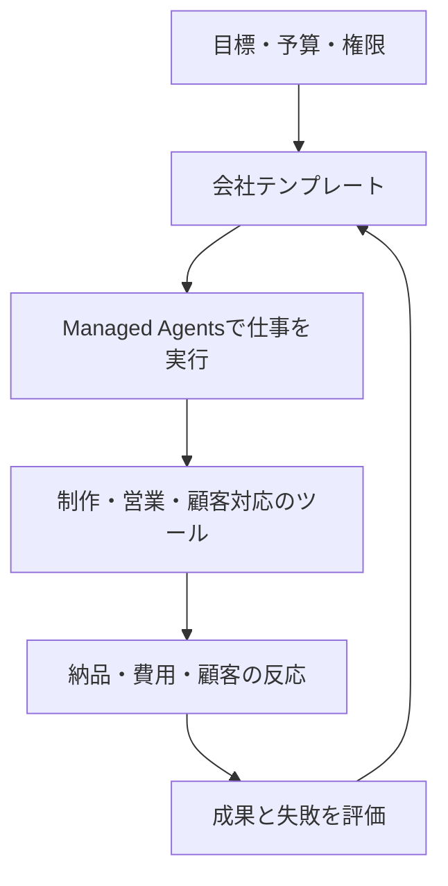

# AIが会社を動かす時代、何を測るべきか――Naïveから学ぶ自律企業のつくり方

編集状態: 出典付き草稿。未公開。公開情報を確認した時点は2026-11-02。企業の自己申告と、私たちの解釈を分けて記載する。

AIが一つの動画を作ることと、動画を売る会社を運営することには距離がある。会社は、誰に何を届けるかを選び、支出を管理し、顧客に応答し、失敗の後にも仕事を続けなければならない。

Naïveが取り組むのは、この距離だ。同社は会社テンプレート、実行基盤、操作画面、評価環境を組み合わせる。私たちが注目する理由も、「エージェントが何回動いたか」から「会社として何を成し遂げたか」へ評価の単位を変える点にある。

ただし、最初に一線を引きたい。自律企業のベンチマークで表示されるドル額は、必ずしも現実の売上ではない。そして、自律企業向け製品をつくる会社が、社員ゼロであるとも限らない。

## Naïveはどんな会社か

YC掲載の会社情報は、創業者をSean DorjeとDennis Zax、チーム規模を12人と記載する。採用情報では$28.5Mの資金調達を説明し、開発者や研究者を募集している。したがって、同社を「人間のいない会社がすでに完成した事例」と紹介するのは不正確だ。[YC掲載情報](https://www.ycombinator.com/companies/naive/jobs/OTnFKjw-founding-member-of-technical-staff-rl)

製品が目指すのは、会社の仕事をエージェントのチームへ渡すこと。その単位は、役割、利用ツール、予算、スケジュールを宣言する会社テンプレートだ。人間が目標や上限を決め、権限によっては実行を承認する。公式ガイドも、人間が完全にループから消えるとは説明していない。[会社の定義](https://usenaive.ai/blogs/what-is-an-autonomous-company)

ここから学べるのは、自律性をスローガンで扱わず、どの判断と操作が人間を必要とするかまで具体化することだ。

## SDKは会社そのものではない

現在の公式ドキュメントは、下層のManaged Agentsと、上層のblueprintを区別する。下層はagent、session、budget、computerなどの実行資源。API・SDK・CLIにはVettaの名前が残る。上層は、その資源を一つの会社へ組み立てるテンプレートだ。[公式docs](https://usenaive.ai/docs)

図は筆者による概念整理であり、Naïveの内部実装図ではない。

古い公式スターターには `@usenaive-sdk/node` が登場する。一方、現在のdocsは `@usenaive-sdk/vetta` を案内する。旧スターターを動かせたことと、現行の会社実行基盤へ移行できたことは、別々に確認する必要がある。[旧スターター](https://github.com/usenaive/naive-starter-template)、[現行docs](https://usenaive.ai/docs)

採用判断でも同じだ。SDKを導入した件数より、実行が中断しても戻れるか、費用を上限内に収められるか、成果物を顧客へ届けられるかを確かめたい。

## ベンチマークで会社を運転する

NaïveのClipping Benchでは、エージェントが約1か月の動画切り抜き事業を運営する。これはコードで決定的に動くシミュレーションだ。初期資金を与え、終端で精算する。何もしない戦略、ルールに沿う固定戦略、内部状態を読むoracleとの比較も示す。[Clipping Bench](https://usenaive.ai/benchmark/clipping-bench)

Short Form Benchは、短尺動画ブランドの運営を扱う。投稿だけでなく、商品、営業、問い合わせ、銀行を含み、現金・在庫・債権債務から事業価値を計算する。視聴者はシミュレーションされるため、その結果を実際の市場反応とは呼べない。[Short Form Bench](https://usenaive.ai/benchmark/short-form-bench)

この形式が有用なのは、失敗の積み重なりを測れることだ。今日は小さく見える在庫判断や記憶の欠落が、数日後の納品や資金に影響する。短い質問への回答精度だけでは、この能力は見えにくい。

さらに、環境に設定されたSNSのcooldownを守れたという結果は、その環境でルールを理解し実行した証拠である。実SNSにも同じ時間制約や倍率があるという発見にはならない。

## 一つのランキングで全部を語らない

比較では、何を固定して何を変えたかが重要になる。

| 問い | 比較の単位 | 読み取れる範囲 |
|---|---|---|
| どのモデルが判断に強いか | 同じ環境・toolsでモデルを変更 | その環境でのモデル差 |
| どの実行基盤が効率的か | モデルを固定して基盤を変更 | 基盤による完了率・費用の差 |
| 実際に事業が成立するか | 顧客・納品・決済・実費を追う | その事業と期間の実績 |

Naïveはmodel比較とharness比較を分けて公開する。ただし、Managed Agentsの説明は試行行が内部DBにあり未公開とも記す。ページに順位があることと、第三者が同じ結果を再現できることも別だ。[評価一覧](https://usenaive.ai/benchmarks)、[Managed Agentsの説明](https://usenaive.ai/blogs/introducing-naive-managed-agents)

## 自律企業の研究はNaïveだけではない

Andon Labsは、Vending-Benchで模擬事業を評価し、実世界の事業運営にも取り組む。Pionの背景記事では、simulationでの能力が現実へそのまま移らないこと、記事時点で店舗とcaféが黒字ではないことも説明する。成功だけでなく隔たりを公開する姿勢は、評価を読むうえで参考になる。[Pionの背景](https://andonlabs.com/blog/why-we-built-pion)

Paperclipは、組織図、予算、目標、governanceを備えるOSSの会社運営基盤だ。公式説明は人間が方向を決め承認する構造を明記する。[Paperclip](https://paperclip.ing/about/)

Conwayのautomatonsは、agentの暗号学的identityとcreatorの登録を扱う。ただし、identityを持つことから、収入で運営費を賄えることまでは導けない。[Conway docs](https://docs.conway.tech/automatons)

これらは同じ主張をする製品ではない。会社の実行、組織の管理、identity、評価環境という異なる部分を見ている。

## 私たちは独自ベンチマークをつくるべきか

私たちの判断は、「既存の評価を利用し、自分たちが解く課題だけを追加する」だ。

自社製品だけに有利な採点をつくれば、見栄えのよい順位は得られる。しかし、顧客の仕事を改善したかは分からない。逆に、外部の一つの模擬環境だけを目標にすれば、自分たちの納品・費用・人間介入の問題を取りこぼす。

AniccaにはすでにLM-EABという経済的自律性の採点基盤がある。現在の5個の公開合成ケースは、金額、費用の欠測、人間介入、重複した証拠などの扱いを検証する。これは採点器のテストであり、エージェントが自律的に利益を出した証明ではない。[再現手順](../evals/lm-economic-autonomy.md)

次に必要なのは、実際にagentが実行する課題だ。たとえば、同じ依頼から受入条件を読み、成果物を納め、請求と費用を照合する。固定script、現行agent、別の実行基盤を同条件で比べる。その際、次の値を一つの点数へ埋め込まずに出したい。

- 完走できた割合と失敗の種類。
- 成功1件あたりの総費用と所要時間。
- 人間や外部AIが手伝った回数と時間。
- 重複・未確認の外部操作。
- 実収入と費用控除後の成果。

自社ベンチマークを育てる目的は、自分たちを1位にすることではない。次の変更が本当に仕事を改善したかを見抜き、別の開発者にも比較してもらうことだ。

## What-if machineへつなぐには

自律企業を動かすagentと、人の反応を予測するモデルは、異なるものを測っている。Simileは顧客、従業員、集団が変化へどう応答するかを扱うsimulationを掲げる。[Simile](https://www.simile.com/)

この二つをつなぐ構想は魅力的だ。運営agentが複数の施策を考え、行動モデルが反応を予測し、実行結果から両者を改善する。ただし、これは私たちの設計仮説である。Naïveが行動基盤モデルや汎用的な反実仮想予測を実証した、という意味ではない。

予測では、まだ見ていない人・期間・環境で当たるかを測る。介入では、予測に沿って行動した結果、実際に人の生活や事業が改善するかを確かめる。模擬顧客の購買額が増えただけで、人間への有効性を主張しない。

## ハッカソンで見せたいもの

NaïveとYCのイベントは、11月7–8日にSan Franciscoで開催する。公式本文はNaïve SDKの使用と、実際に動く会社のデモを求める。[YC公式イベント](https://events.ycombinator.com/naive-autonomous-companies-hackathon)

そこで見せるべきものは、大きな組織図より、一つの仕事の完走だ。誰の依頼を受け、agentが何を決め、何を届け、いくらかかり、どこで人間が手伝ったのか。その連鎖を短いデモで追えるようにする。

事前開発した成果物の持込みが無条件で認められるとは、確認した公開規約からは言えない。準備を進めつつ、既存部分と会期中の変更を明示する必要がある。

私たちがNaïveから取り入れたいのは、会社を再現可能な実行単位として扱い、その性能を測る姿勢だ。事業の実行、比較評価、現実の顧客成果を一つずつ接続する。その積み重ねが、「AIが働いた」という記録を、「人間の追加作業を減らし、価値を届けた」という証拠へ変える。
