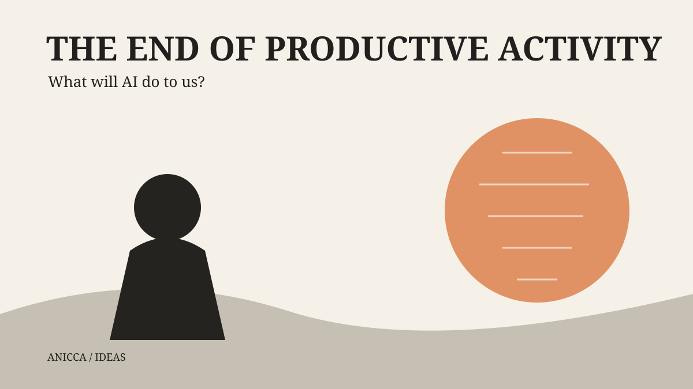
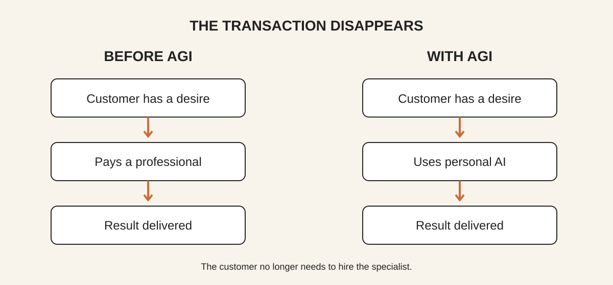
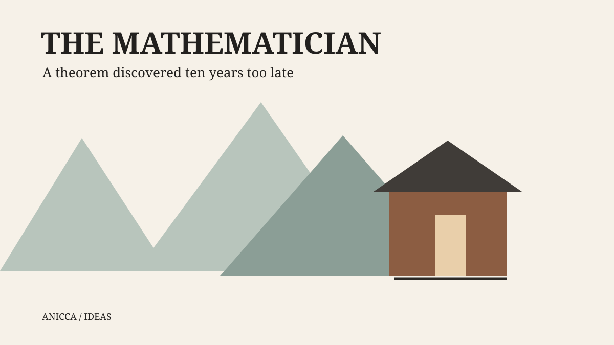
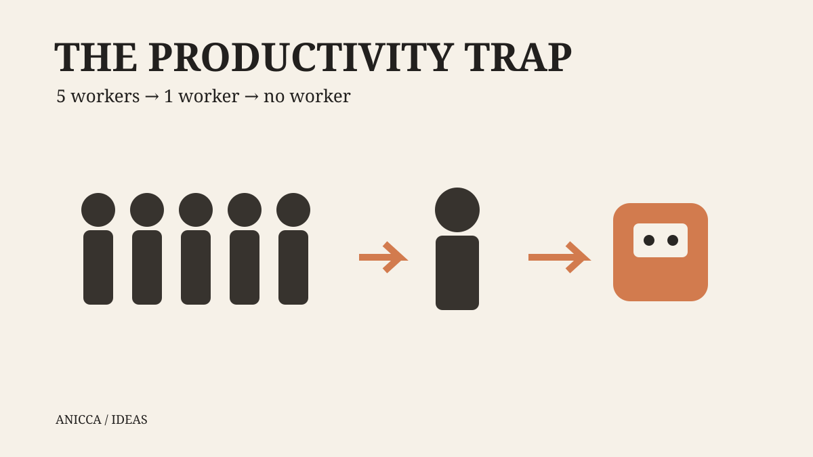
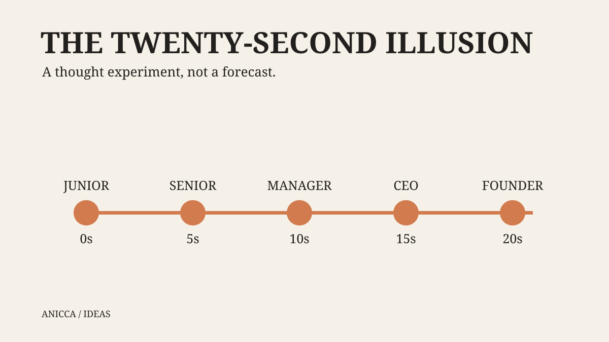
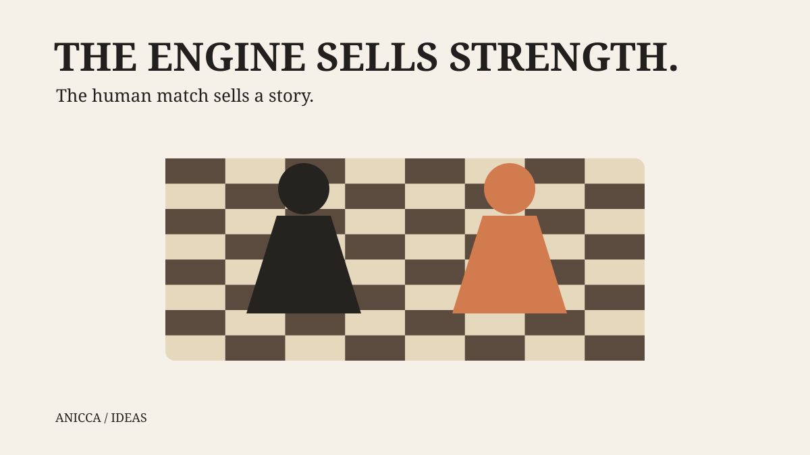
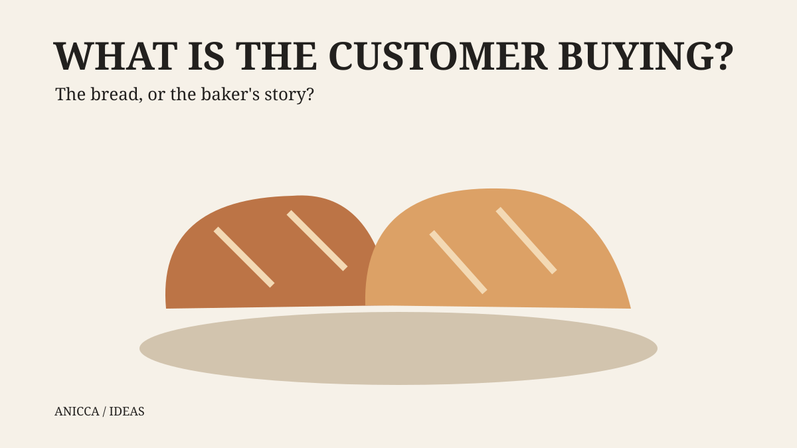
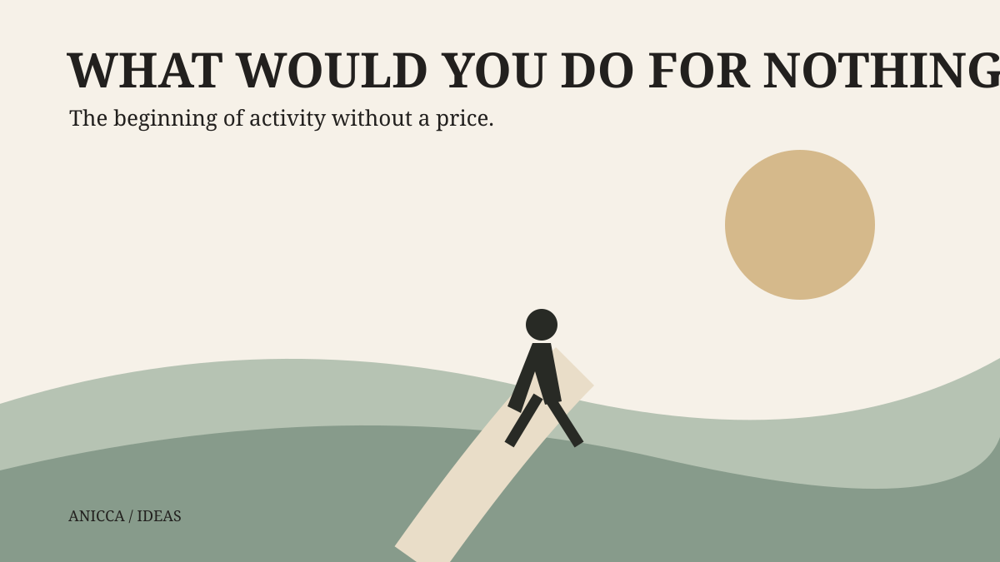

# AIはすべてのプロをアマチュアに変える

*生産的活動の終わり*

AIはソフトウェアを書き、数学を証明し、会社を経営する。だが、どの職業から消えるのかという問いは本質ではない。

**AIはすべてのプロをアマチュアに変える。**

**AIで生産性を高めれば仕事を守れると思うなら、AIが不要にしようとしている能力を必死に磨いていることになる。**

## TL;DR

人が雇われるのは、顧客が自分では得られない成果を、速く、安く、上手に提供できるからだ。十分に高性能なAIで顧客が成果を直接得られれば、人間を雇う理由は消える。AIを使いこなすことは今の競争では役立つが、永遠の防御策ではない。

チェスのプロが今も報酬を得るのは、観客が最善手ではなく人間同士の物語を買うからだ。その市場さえ永遠に安全とは限らない。

## なぜ人は他人にお金を払うのか？

欲求があり、自分では満たせないからだ。ソフトウェアが必要ならエンジニアを、市場分析が必要ならコンサルタントを雇う。

**欲求 → 専門家への支払い → 結果**

しかし十分に有能なAIがあれば、

**欲求 → 自分のAI → 結果**

となる。

機械が専門家の席を奪うだけではない。顧客が専門家を雇う必要そのものを失う。

## それでも数学者にはなれる

ノルウェーのツリーハウスでネットを切り、十年間数学に取り組む。美しい定理を発見する。しかしAIは何年も前に証明していた。

十年は無駄か？ 数学が好きなら違う。しかし、すでに得られる結果に誰が報酬を払うだろう。

ここでいうアマチュアとは下手な人ではない。報酬がなくても活動する人だ。

**AGIは活動を終わらせずに、職業を終わらせる。**

## 生産的活動の終わり

生産的活動とは、利益、効率、成果など外的な結果を主目的とする活動だ。雇われるために学び、製品を出すためにコードを書く。AIが結果をよりよく作るなら、人間が行う生産性上の理由は崩れる。

これは成熟したAGIについての仮説であり、今すべての仕事が消えたという話ではない。所有権、資源、制度、アクセスの問題は残る。それでも、人間の生産性が人生の目的であり続ける保証はない。

## AI時代で最も危険なキャリア助言

「AIがあなたの仕事を奪うのではない。AIを使う人が奪うのだ。」

移行期には正しいかもしれない。しかし一人がAIで五人分、次に五十人分の仕事をし、最後に顧客がAIを直接使ったら？

あなたが証明した生産性向上は、あなたを雇う必要がなくなる証拠になる。

シリコンバレーの実力主義は、速く製品を出し、難問を解き、価値を生む人を称賛する。現在の経済では当然だ。

**しかし、そこにこそ罠がある。**

仕事が自律的に実行されるなら、最も生産的な人間であることは、人間が必要とされる保証にならない。

**同僚との競争に勝っても、同僚という存在が必要かという競争には負けるかもしれない。**

AIで生産性を上げることは移行期の戦略だ。到達点で生き残る戦略ではない。

## 二十秒という幻想

ジュニア、シニア、マネージャー、CEO、創業者。人々はこの順番で置き換わると考え、上の立場ならまだ時間があると安心する。

しかし再帰的自己改善が高速なら、その能力差が二十秒で埋まるかもしれない。これは予測ではなく思考実験だ。現実には導入や制度の制約もある。

最後まで必要とされたと二十秒喜んで、その後不要になる。そんな地位に人生を賭けたいだろうか。

## なぜマグヌス・カールセンは今も報酬を得るのか？

チェスエンジンは人間を超えた。それでも観客はカールセンの対局を見る。

命を賭けた対局で代役を選ぶなら、最強のエンジンを選ぶだろう。欲しいのは最善手だからだ。

しかし観戦では違う。カールセンの歴史、ライバル、緊張、勝利と敗北を見たい。

**エンジンが売るのは強さ。人間の対局が売るのは物語だ。**

## チェスはエンターテインメントだ

棋士は知的労働者に見える。しかし観客が買うのは計算ではなく娯楽だ。最強AI同士の大会も研究者には面白いだろうが、強い指し手だけで人間のライバル関係と同じ商品にはならない。

パン屋も同じだ。多くの客はおいしく便利で安いパンを求める。自律システムがもっとよいパンを作れば、普通のパン屋は結果で競争する。職人への愛着は別の価値になり得るが、物語だけでまずいパンは救えない。

**手を使うか頭を使うかではない。顧客が何にお金を払っているかだ。**

## あなたのコンサルティングはチェス大会ではない

企業はコスト削減、売上、戦略、問題解決のためにコンサルタントを雇う。格闘する姿を観戦したいのではない。

SaaSの顧客が欲しいのは動く製品だ。ChatGPT、Claude、Grokを乗り換える人も、主に目的に合う性能や価格、信頼性を選んでいる。

魅力的な創業者でも顧客を失う。社内で人気でも市場では負ける。

## 創業者さえ例外ではない

「AIはコードを書けても何を作るかは決められない。」

なぜだろう。ニーズの発見、仮説、製品設計、実験、予算配分、戦略もAIが担い得る。

「創業者は会社を所有している。」

所有と運営に必要とされることは違う。

顧客が自分のAIで解決策を作れるなら、そもそも製品を買う必要があるだろうか。

**創業者は自動化の最後のボスではない。**

## ならば物語を売ればいい？

個人ブランドやコミュニティ、感情的なつながりには価値がある。しかし**製品に付け足した物語と、物語自体が製品であることは違う。**

百万のフォロワーがいる人がB2B分析ツールを売っても、企業は正確さと費用対効果を求める。

データサイエンス講座はAI家庭教師と、行動変容を売るアファメーションアプリは高性能なAI介入と比較される。

特定のクリエイターの人生や日々の瞑想を追うために購読する人もいるだろう。それは関係や体験を買うことだ。しかし無敵ではない。

## AIも物語を語れる

AIが魅力的なキャラクター、関係、コミュニティ、歴史を作り、個人に合わせた体験を提供したら？ ロボットや没入型環境がそれを物理世界に広げたら？

「本当に私が発信している」と知ることを大切にする人はいる。しかし体験の質を重視する人もいる。

**「人間らしい」というだけでAIとの競争を免れる商品はない。**

何の欲求を満たすのか。なぜ顧客はあなたに払う必要があるのか。

## Distributionは単なる集客ではない

ベンチマークで顧客を獲得しても、それだけが利用理由なら、他社が勝った瞬間に乗り換えられる。

物語はAboutページのスローガンではない。実際の体験に組み込まれなければならない。

Managerも例外ではない。効果的な行動介入だけを売れば、介入効果で競争する。私たちにできるのは、探究する問い、実験、失敗、意思決定を公開し、機能一覧ではなく継続する旅を見せることだ。製品は動かなければならず、物語は本物でなければならない。それでも永久の安全はない。

**強い物語は愛着を生むかもしれない。しかし性能の代わりにはならず、AIもその愛着をめぐって競争できる。**

## では何を作ればいいのか？

永久にAIから守られるビジネスを探すのはやめよう。今の市場機会を、永遠の人間の優位性と混同してはいけない。

成果を売るなら成果で競争する。体験を売るならAIがもっと魅力的な体験を作れるか考える。あなたへのアクセスを売るなら、顧客が本当にあなた自身を求めているか確かめる。

それをまた生産性向上のチェックリストにしては、本質を見失う。

## 無報酬でも何をする？

私にとって一つの答えは瞑想だ。瞑想したいから瞑想する。給料も生産性の証明もいらない。

柔術もする。散歩も好きだ。コメディも好きだ。誰も笑わなくても、自分が笑えるものを作りたい。

世界一歩くのが上手でなくても散歩は楽しい。AIに柔術で勝てなくても練習できる。

**誰もお金を払わなくても、あなたは何をする？**

**あなた以外の誰も望まなくても、あなたは何をする？**

生産性やスキルや個人ブランドのためではない。ただ、やりたいからやることは何か。

## 最高である必要はない

私たちは専門家になり、雇われ、会社を作り、価値を証明することを中心に生きてきた。

AIの所有権、資源、所得分配、住居やエネルギーの問題は残る。知能が豊かになっても物質的なものが自動的に無料になるわけではない。

それでも問いたい。**生産性で存在を正当化しなくてよいとき、人間は何のために生きるのか？**

数学も文章もものづくりもチェスも続けられる。アマチュアとして。

そして、その言葉はもう格下げではないかもしれない。

**AIはすべてのプロをアマチュアに変える。**

活動の終わりではない。

**生産的活動の終わりだ。**

そして、ただやりたいから何かをする人生の始まりかもしれない。

---

*編集注：これは成熟したAGI社会についての論考であり、すべての職業が特定の時期に消えるという実証済みの予測ではない。二十秒という数字は思考実験である。*
