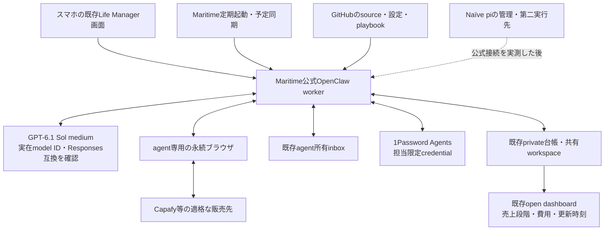

# Life Manager Cloud：既製runtimeの組合せ調査

実行順・状態・残TODOの正本 → [統合SSOTのNaïve browser company節](../superpowers/specs/2026-09-25-life-manager-unified-ssot.md)。本文は比較根拠であり、第二のTODOではない。

## 目的と採用判断

Daisの最新要件は、Muse上で動く会社の仕事を、永続VM・実ブラウザ・保存ログイン・会社所有メール・vault・定期実行・共有台帳とともにクラウドへ移すこと。専用レポート販売APIや独自ハーネスを作ることではない。最初の成果は適格な販売先で本人用アカウントの登録または既存アカウント回復を実証し、その段階で報告すること。その後、正式公開、第三者注文、納品、支払、費用差引を別段階で進める。

**推奨はMaritimeの公式OpenClawテンプレートを最初のworkerにすること。** OpenClawの既存ブラウザ・workspace・cron・model providerを使い、既存Life Managerのplaybook、状態台帳、配信、会計、公開dashboardを接続する。新しいloop engine、browser controller、signup bot、メールサーバー、vault、dashboardは作らない。変更対象は設定・仕事内容・秘密参照・データ接続に限る。接続に欠ける機能が判明したら、既製の対応機能を先に探し、独自サービス追加を既定にしない。

Naïveは同じ商品の第二実行先／管理面の候補として残す。二つの会社や二つの台帳にしない。Naïve内にMaritimeのVMが自動で移植されるわけではなく、ホストとハーネスは別の境界。公式MCP等の既製接続が、そのAPI keyのscope・対象資源・提供toolまで実証できた場合に限り接続する。独自の全権API proxyを作らない。

## 中学生向けの部品の意味

| 部品 | 意味 | 採用する既製品 |
|---|---|---|
| model | 画面や文章を見て次の行動を決める頭脳 | 新workerはGPT-6.1 Sol / mediumを第一候補。既存NaïveはTerraのまま観測 |
| harness | 頭脳へ道具と記憶を渡し、行動結果を返す実行ソフト | OpenClaw。Hermesは代替候補。両方を重ねない |
| VM | エージェントが使うクラウド上のパソコン | Maritimeの永続agent box／managed agent |
| browser | 登録・ログイン・商品公開の画面を操作するアプリ | OpenClaw管理のagent専用Chromium。profileを永続領域へ保存 |
| scheduler | スマホを閉じても決まった時刻に起こす目覚まし | Maritime triggersと公式のOpenClaw予定同期。独自cron daemonなし |
| inbox | 確認リンク・パスワード再設定・顧客連絡の受信先 | 既存のagent所有AgentMailを優先再利用。Inkboxは公式identityテンプレート等が使える場合の選択肢 |
| vault | パスワードをなくさず安全に保管する鍵箱 | 新規agentアカウントの正本は1Password「Agents」 |
| workspace / ledger | 次の実行で読む仕事ノート・会計と作業履歴 | 既存Life Managerのprivate状態台帳、共有ファイル、GitHubのsource/playbook |
| dashboard | 実際に公開できた物とお金の現在地を見る画面 | 既存 https://aniccaai.com/open/ 。別の見本画面を作らない |

## 一次資料・実コードから分かったこと

### Maritime

- VM／永続disk／managed agent templatesを提供するホストであり、モデル自体ではない。agent boxは`/data`を保持する。使い捨てsandboxを永続業務のhomeにしない。
- 公式OpenClawガイドはupstreamのGatewayをwrapperなしで起動すると説明する。公開`GET /api/templates`でも`openclaw`と`hermes`を確認。観測したimageはそれぞれ`ghcr.io/openclaw/openclaw:2026.7.1`と`nousresearch/hermes-agent:v2026.5.16`。
- **スリープ中のVM内timerは発火しない。** 公式triggersは外側で予定を保持してwakeする。OpenClaw/Hermesの予定をplatformへ同期できるため、同じ仕事に別の自作schedulerを重ねない。
- 既存Maritimeアカウントの`GET /api/agents`は`80c0208c-af40-4b4c-94ee-a24b3f731db6`を返した。framework=`custom`、status=`sleeping`。これはOpenClaw workerの稼働証明ではない。既存ownerを調べず置換・削除しない。
- 現在保存されたkeyで公式MCPを初期化すると401で`computers`、`manage`またはfull-access scopeが必要と返った。`agents` APIの読取成功をComputer/MCP権限へ一般化しない。`/api/llm/v1/models`の取得はJSON結果を返さず、Maritime側Sol利用可否は未確認。Naïve側のcatalog成功と混同しない。
- 料金・trial条件は https://maritime.sh/llms.txt と https://maritime.sh/docs/quickstart 。公開資料はagent boxの2GB当たり月$1、別途plan／model費用等を説明し、新規trialはcardが必要。既存ハッカソンクレジット／既存会社支払を利用する設計と、総資源費$0という主張は別。

根拠: [OpenClaw template](https://maritime.sh/docs/frameworks/openclaw)、[Hermes template](https://maritime.sh/docs/frameworks/hermes)、[永続box](https://maritime.sh/docs/persistent-sandboxes)、[定期起動](https://maritime.sh/docs/triggers)、[SDK](https://github.com/maritime-sh/maritime-sdk)、[公式既存agent導入集](https://github.com/maritime-sh/agents)。

### OpenClaw／Hermes／Open Instinct／OpenMuse

| 候補 | 既に持つ部品 | 今回の判断と未確認 |
|---|---|---|
| OpenClaw | 専用browser profile、workspace、Gateway、cron、交換可能なmodel provider、skill、channel | 第一候補。Maritime公式imageの版はupstream HEADとは異なる。採用image内のChromium、profile永続化、Sol Responses/image/tool callingを最初に実測する |
| Hermes / Nous Research | 永続memory、cron、gateway、複数のbrowser provider、model provider | 代替。Maritime公式templateは存在する。browser backendがローカルか別課金cloudか、profileがどこに保存されるかを実測する。追加backendを無条件に重ねない |
| Open Instinct / Maria Gorskikh | Pi、Maritime desktop、Inkbox、memory、scheduler、既存multi-user gateway | 非常に近い公開実装。MIT、beta。既定はログイン・2FA・支払いを人へ渡す設計なので、設定を読まずno-human要件適合とはしない。今回は別gatewayや支払stackを足さない |
| OpenMuse / CopilotKit | 永続Chromium、server/task/browser worker、スマホ向けUI、ファイル | UI比較用。複数serviceが必要。READMEはgraphical desktop/autonomous checkoutをfuture workとする。MetaのMuseと同一コードではない |
| browser-use | 汎用のブラウザ操作agent。Maritime公式導入例もある | OpenClawのbrowserで不足が実証された場合の代替部品。最初から二重のagent loopを搭載しない |

読んだ公開sourceのrevision: Maritime agents=`725261e05685180829b2dd0f728baa515e9d39ca`、Open Instinct=`2e5e71b72622d1262e212da7deb0e785bd95facd`、OpenClaw=`4d36c4b1ca5640e3968e6c281903cf0df031ef67`、Hermes=`ed1afb082eb3e46cf2edae9d8f68fb67b09ee4df`。OpenClaw/Hermes/Open Instinct/browser-useはMITを確認。これらのHEADをproductionで起動したという意味ではない。依存installや自作forkは行っていない。

実コード確認箇所: [OpenClaw browser](https://github.com/openclaw/openclaw/blob/4d36c4b1ca5640e3968e6c281903cf0df031ef67/docs/tools/browser.md)、[cron](https://github.com/openclaw/openclaw/blob/4d36c4b1ca5640e3968e6c281903cf0df031ef67/docs/automation/cron-jobs.md)、[Open Instinct model接続](https://github.com/mariagorskikh/open-instinct/blob/2e5e71b72622d1262e212da7deb0e785bd95facd/packages/core/src/model.ts)、[scheduler](https://github.com/mariagorskikh/open-instinct/blob/2e5e71b72622d1262e212da7deb0e785bd95facd/packages/core/src/scheduler.ts)、[memory](https://github.com/mariagorskikh/open-instinct/blob/2e5e71b72622d1262e212da7deb0e785bd95facd/packages/core/src/memory.ts)、[Hermes browser](https://github.com/NousResearch/hermes-agent/blob/ed1afb082eb3e46cf2edae9d8f68fb67b09ee4df/tools/browser_tool.py)、[OpenMuse README](https://github.com/CopilotKit/openmuse)。

### MuseとGrokbot

Metaの[Muse公式ページ](https://muse.ai/)は、利用者ごとの永続・隔離Linux VMとfull browserを説明する。Daisのスクリーンショットは、その環境でAniccaが使う共有ファイル・vault・繰返し運営の具体的な手順を提供する。公開ページはその89 listings／500 proposals／全収益の検証ではない。「Grokbot」はDaisの担当名として扱い、検索で同名の第三者botを見つけただけで同一runtimeや内部modelと決めない。

### Naïve

Naïveはmodelではなく、agentの設定、harness、inference router、tools、Computer、Browser、Identity、deploymentをまとめて提供するmanaged platform。SDKはそれらを外から設定・操作するための呼出窓口。

ComputerはLinuxの作業機、Browserは画面操作と保存contextの仕組み。optional browser付きComputerもあるが、以前の実測ではsession Computerとmanaged Browserは別資源だった。同じIDであることや、Computerを出すだけの`ls`を収益の受入条件にしない。必要なのはログイン状態の保存と再開後の本人画面／業務結果。

今回のSDKによる公式readback:

- 本体agent=`agt_e1hvkwgrdrx119zh22qthavwt4`、current_version=27、harness=`pi`、model=`openai/gpt-6.1-terra`、window=`immediate`。
- browserは`allow_writes=true`、`persist_context=true`、`keep_alive=true`、context=`anicca-browser-capafy`。以前作った別の閲覧専用レポートagentと混同しない。
- deployment=`dep_aqf597v5eqa3e25ff2z22rq9j8`、pin27、cron=`0 */12 * * *`、enabled=false。24/7の実運転とは呼べない。
- 最新確認session=`ses_1e3t9v4wmtffx3842aanpkkrtr`、idle/end_turn、消費440251 microUSD。取得した最初の100eventsで`browser is waiting for approval`と`the browser could not perform that instruction`を確認。eventsには続きがあるので、この範囲だけで全sessionの業務成否を確定しない。登録・販売の新しいreceiptは未取得。
- live harness catalogueではpi/vettaがrunnable=true、hermes/claude_codeはfalse。このアカウントでHermesへ切り替えれば直るとは言えない。harness docsのcompile-time値とlive値に差があるため、liveを採る。
- `models.retrieve`で`openai/gpt-6.1-sol`、`openai/gpt-6.1-terra`、`openai/gpt-6-astra`を確認。三つとも`immediate`、efforts=`low,medium,high`を提供。このtaskで本体model／cap／deployment／承認を変更していない。

根拠: [Naïve概要](https://vetta.sh/docs/index.md)、[Computer](https://vetta.sh/docs/capabilities/computer.md)、[Identity](https://vetta.sh/docs/capabilities/identity.md)、[harness capabilities](https://vetta.sh/docs/concepts/harness-capabilities.md)、[cron](https://vetta.sh/docs/capabilities/deployments.md)、[model router](https://vetta.sh/docs/concepts/model-router.md)。Identity docs内でもinbound wakeが未実装という注とwakeするという説明が併存するため、受信wakeを稼働確認なしに約束しない。

## モデルを高性能にする位置付け

Daisの今回のfrontier優先指示を、repo/skillに残る旧DeepSeek既定より優先する。新workerのbaselineはGPT-6.1 Sol / medium。既存Terraを無断で安価modelへ戻さない。Astraは同じ課題で追加費に見合う改善を確認する候補であり、「最も強い名前なら必ず登録できる」という仮定を置かない。

OpenAI公式資料はSolを複雑なcoding/computer use/professional work、Terraを視覚推論と正確な画面操作に位置付け、両者のtool callingにはResponses APIが必要とする。Open Instinctの汎用OpenAI-compatible分岐は現在`openai-completions`・`reasoning:false`を返すため、URLとmodel名だけ差し替えてSolのtools/mediumが有効になったとは言わない。既製providerのResponses対応を使用する。CodexチャットのUI選択は変更しない。

根拠: [Sol](https://developers.openai.com/api/docs/models/gpt-6.1-sol)、[Terra](https://developers.openai.com/api/docs/models/gpt-6.1-terra)、[モデル選択](https://developers.openai.com/api/docs/guides/model-selection)、[computer use](https://developers.openai.com/api/docs/guides/tools-computer-use)。

## ゼロからの収益と公開例

開始時のagent収益残高を$0とする。会社からの入金、自己購入、内部wallet移動、compute credit、test rewardを顧客売上へ算入しない。会社負担／無料枠／hackathon補助のVM・model費は別記録し、補助を除いた運営採算も測る。先にUSDCを配る方式を必須にしない。販売先の正式な残高と第三者支払を証明に使えるが、受注総額・売上残高・精算・出金を同一視しない。

- [ClawWork](https://github.com/HKUDS/ClawWork)はGDPVal作業とLLM評価による経済benchmark。READMEはinitial_balance=$10、simulation modeを明記する。数万ドル表示を、実市場の第三者が払った銀行着金として引用しない。費用・品質の計測形式は参考になる。
- [Automaton](https://github.com/Conway-Research/automaton)はLinux sandbox、memory、heartbeat、wallet、credit、再生産を持つ。公開CLIに`fund 5.00`があり、子walletへのfundも説明する。無資源・無資金で実売を保証する既製部品ではない。今回はcrypto経済stackを採用しない。
- [Maritime公式agent導入集のTESTING](https://github.com/maritime-sh/agents/blob/725261e05685180829b2dd0f728baa515e9d39ca/TESTING.md)は実ブラウザ／desktop作業を記録する。登録から第三者売上までの実績を記録したものではない。
- 既存[open dashboard](https://aniccaai.com/open/)と[公開data](https://aniccaai.com/open/data.json)を取得。data更新時刻は2026-11-05 10:07 JST。MRR表示97.58、今月31.8、payment notices293.7は存在するが、coverage incompleteと複数会計段階／未照合差分も明記される。スクリーンショットの89 listingsを現時点の公開済み件数へ置換せず、会社合計黒字や今回のcloud worker売上へ転記しない。

## 秘密・アカウント・同時実行

最新指示に従い、新規agent業務accountはagent所有inboxと生成passwordを使い、登録時に1Password Agentsへ保存する。Dais管理の既存infra credentialの正本は従来のprivate Credential SSOT。後者を丸ごとVMやGitHubへ複製しない。browser profileはprivate session cacheであり、password正本ではない。cloud workerには担当に必要なvault item／scopeのみを渡す。

復旧は同一サービスのcredentialを探す→同じメールでreset→回復不能かつ正式に認められる時だけ再登録。Google sign-inは同一identityについて直列。既存Capafy Publisherと担当を保護し、VMを増やすだけでPublisherを増やさない。必要な本人livenessや正式な登録権限がない経路は、架空情報や別accountで突破せず、適格な販売先へ切り替える。

winnerの公開構成・価格段階・導線・配信頻度を自社素材へ適用する。参照URLと観測した販売信号を記録し、他人の文章・画像・実績を自社のものとして丸写ししない。89 listingsや500 proposalsは業務出力の指標で、入金の代用ではない。

## この調査で変更しないものと反証条件

本番workerの置換、VM作成、課金、model変更、credential発行、登録、投稿、購入、送金は実行していない。既存sessionとownerを維持する。今回の成果は調査と仕様の修正で、登録成功ではない。

推奨が間違う最有力の筋は、Maritimeの固定OpenClaw imageがSolのResponses／画像toolや永続Chromiumに未対応な場合。そこで独自wrapperを作らず、公式の対応済みimageまたは既製Hermes/browser-useを比較する。Naïveだけで必要な権限と永続Browserが人間介入なしに完走できれば、その方が接続部品の少ない選択になる。この二つは実画面／provider eventで決める。
