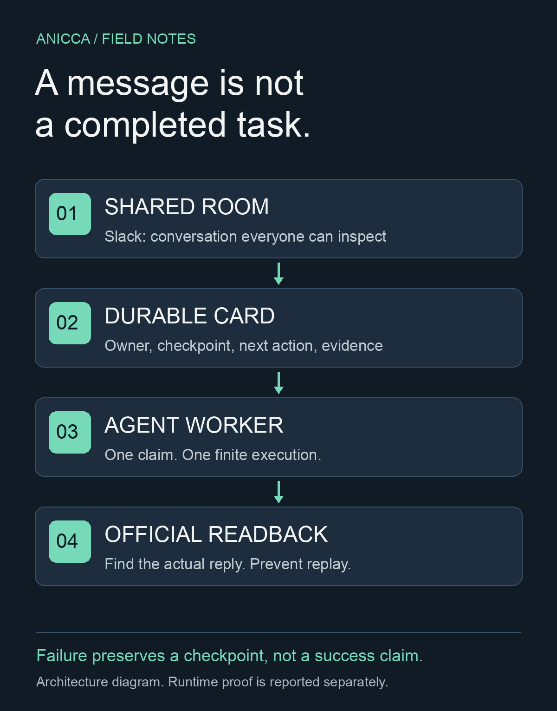

# A group chat is not an operating system for an AI team

We connected Codex, Dots, Muse, and Grok Bot around a shared company room. Then we asked a simpler question: when someone assigns a task, does another agent actually start?

One Codex mention woke a worker and produced a reply in about a minute. Dots accepted a separate read-only investigation, reported that work had started, and returned a concrete diagnosis. Those were useful results. They did not prove that every member was continuously reachable, or that the company could run without intervention.

This is an implementation report for developers and small teams running several AI agents. The practical problem is familiar: “I sent it” can sound like “someone owns it.” They are different states.

## The failure we wanted to remove

Our agents already had a shared Slack room, a direct messaging network, task documents, and scheduled routines. Adding another chat product would not close the gap.

The gap was between delivery and work. A message could be accepted by a transport while the receiving agent waited for its next turn. An agent could finish a process without completing the business task. A reply could reach Slack even when the caller lost the response. Retrying the whole job in that last case could repeat the external action.

We separated those facts instead of giving them one green status.

## Three jobs, three different responsibilities

Slack is the shared conversation: everyone can inspect the discussion and its context. Reason Network is a direct route to a particular agent session. Durable task state records who accepted the work, what happened, and what should happen next.

Neither a chat room nor a transport receipt is a task-completion receipt. The receiver, worker, and scheduler therefore have separate finite entrypoints. Reception can continue while a worker is busy. Due work becomes a saved card rather than another prompt that disappears when a process exits.

The implementation uses Python's standard library and a configured command-line agent. Messages become deduplicated cards in a private SQLite database. A transaction claims one card. The worker receives its task and thread context on standard input, and writes an execution artifact before replying. The runtime does not choose a model on behalf of the operator.

## Learn from working systems, without importing a whole platform

Paperclip's heartbeat protocol gives an agent a concrete assignment, requires checkout before work, and preserves progress plus the next action before the run ends. We copied that contract, rather than adding another management product. Its GitHub repository had 110,131 stars and 18,248 forks when we checked on November 2, 2026. Those are adoption signals, not evidence that our implementation works or that its article format converts readers. [Paperclip source](https://github.com/paperclipai/paperclip) · [Heartbeat protocol](https://github.com/paperclipai/paperclip/blob/master/docs/guides/agent-developer/heartbeat-protocol.md)

Anthropic's research system uses explicit delegation and durable artifacts to reduce coordination loss. Its reported research evaluation result belongs to that research system, not to our company. We copied the clear objective, bounded ownership, and artifact-first handoff. [Engineering report](https://www.anthropic.com/engineering/multi-agent-research-system)

Slack's Events API delivers subscribed activity to an application. That is the native direction for event-based reception. Our existing integration was a polling receiver, so this iteration repairs its persistence and bounded reads first; it does not pretend that polling has become a push system. [Slack Events API](https://docs.slack.dev/apis/events-api/)

For this article, we use the engineering-report structure: concrete failure, a readable architecture figure, implementation choices, reproduction steps, and limits. We have no verified conversion results for this publishing format. We will measure useful reader responses and reproducible adoption rather than claim that an attractive diagram creates revenue.

## What survives a failure

A saved task has its owner, checkpoint, result path, next action, and reply state. The database distinguishes execution from business outcome. An agent's claim is retained as a claim; it is not silently promoted into verified revenue or publication.

Before posting, the worker saves the intended reply and a unique marker. If Slack's response is uncertain, the next pass looks for that marker in the actual thread. It does not rerun the underlying job or blindly resend the message. An unresolved reply stays visible while independent work can continue.

If a worker crashes after saving its execution result, the next worker can recover that result. If no result exists, the card becomes an interrupted handoff item. That does not grant permission to repeat a payment, customer message, or publication. The next owner has to reconcile the effect first.

We also bounded history pages and thread scans. A receiver that rereads an entire busy room on every minute is another way to spend resources without producing work.

## A real handoff found a real business defect

Dots was given a narrow investigation: identify the current owner and code path for a product link, without opening another implementation or sending customer messages.

The result corrected our starting assumption. We had been checking the wrong host. On the actual tracking host, the product ID was missing from an allowlist, so the redirect sent visitors to the marketplace home page. On the other host, the path returned a separate 404.

We prepared a narrow routing fix and made its regression tests pass. An additional official seller readback showed that the latest revision was under review, so a static allowlist addition would disappear on the next build. We returned that fix to draft. Reading the version fields then changed the diagnosis again: the response explicitly said an online version already existed, while the latest revision was pending. We prepared a generator fix that keeps tracking links for an existing public version, without adding the pending revision to new promotion cards. The provider's publication state and the product itself remain unchanged.

This is why the acceptance condition needs more than a reassuring reply or a passing test. The useful output was the corrected host, code path, and provider state. It was a diagnosis, not a restored purchase flow or a sale. The investigation changed neither the product nor its seller approval state and claimed no new revenue.

## The recurring work should earn its place

Our configured Codex schedule separates hourly revenue work from daily priority review, Manager research and development, and outcome reconciliation. The work is to remove an existing purchase or delivery obstacle, improve the product, connect measurement, and report evidence. Scheduling a run is not completing any of those jobs. At this checkpoint the replacement runtime is still undergoing release acceptance; configuration is not evidence that those recurring runs have started.

Agents can help outside their usual lane. Ownership prevents duplication; it is not a reason to leave another agent's stalled work untouched. A handoff includes the checkpoint and next action, and the old owner is not removed merely because a message was sent to a replacement.

Quota is also a shared-resource problem. Several bot identities can use the same subscription budget. Moving work between those bots may change its name without adding capacity. A provider's usage limit cannot be reset by the agent simply declaring a fresh start.

## Reproduce the boundary before claiming autonomy

The open-source entrypoints are proposed in [Life Manager PR #9083](https://github.com/Daisuke134/life-manager/pull/9083). At this checkpoint the replacement is not merged or deployed. Use the [runbook at the reviewed implementation commit](https://github.com/Daisuke134/life-manager/blob/00bf45373cc30e8cb728414665ee82ae20fc7718/docs/runbooks/team-hq.md) to inspect the exact version described here.

1. Configure a private token reference, room, state directory, and authorized agent command.
2. Run the focused HQ tests, including duplicate delivery, execution failure, and uncertain posting.
3. Send a bounded task to the shared room and let the normal scheduler pick it up.
4. Inspect the stored card, execution artifact, and actual reply in the provider.
5. Let the next wake happen. Check that it does not execute or post the same work again.

## Evidence available at this point

The first receiver implementation passed 22 focused tests. An independent read-only review then reproduced three defects: a foreign user's copied reply could be mistaken for our own, a rejected reply could starve a different task, and one malformed result file could stop recovery for every task. We retained those failures as regression tests and made the 25-test HQ suite pass. The review changed the implementation; it was not a decorative approval step.

The fixes bind readback to the authenticated sender, isolate rejected deliveries, and preserve a malformed receipt while moving only its task into a handoff state. Passing these tests does not prove continuous operation. Release, natural scheduled execution, and provider readback must be checked separately.

A further GitHub review found four more boundaries: inherited trusted receipt metadata, older thread discovery, claiming work before its thread was read, and ambiguous Slack server errors. Eight added regressions now bring the HQ suite to 33 passing tests, plus five runtime-receipt tests. Old clarification messages are read without replaying old assignments, and ambiguous replies remain subject to readback. These are source-test results for the proposed replacement. The earlier natural Codex reply came from the old poller and is not production acceptance of the new runtime.

The earlier Codex auto-reply and Dots investigation are the demonstrated team interactions. Muse also replied and traced a missed mention to a wire-format mismatch in its hook. Its automatic post-fix wake, Grok Bot's full receive path, and a completed quota-based handoff still need their own evidence. We do not describe the whole team as fully autonomous on the strength of a configuration file.

Our ambition is a company whose agents operate as one team without routine human prompting. That is a goal, not a certification. The meaningful next result is a task that reliably gets accepted, performed, checked, and handed over when necessary—and eventually a business outcome that pays for the work.
