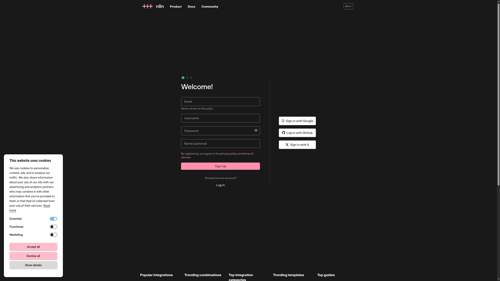

# Can an AI Run a Business? What We Actually Tested on Naïve


*Real Naïve cloud-browser screenshot from our editing probe. The title is present; the body remains empty. This is a failed input checkpoint, not a published article or revenue receipt.*

Public research notes. Verified facts and our interpretation are recorded separately. As of November 3, 2026.

There is distance between an AI making one video and running a company that sells videos. A company must decide who to serve and what to deliver, manage spending, respond to customers, and continue working after failure.

Naïve addresses this distance. The company combines templates, execution infrastructure, control interfaces, and evaluation environments. We pay attention because the unit of success shifts from "how many times did the agent run" to "what did the company accomplish."

One important boundary: the dollar amounts shown in autonomous company benchmarks are not necessarily real revenue. Companies building products for autonomous enterprises do not necessarily have zero employees.

## What is Naïve

YC's public information lists founders as Sean Dorje and Dennis Zax, and team size as 12 people. Their job postings explain $28.5M in funding raised and recruit developers and researchers. It is inaccurate to describe them as "a completed example of a company with no humans." [YC public profile](https://www.ycombinator.com/companies/naive/jobs/OTnFKjw-founding-member-of-technical-staff-rl)

The product aims to hand company work to agent teams. The unit is a company template that declares roles, tools, budget, and schedule. Humans set objectives and spending limits; depending on permissions, they approve execution. Official guides do not claim humans disappear entirely from the loop. [Company definition](https://usenaive.ai/blogs/what-is-an-autonomous-company)

The lesson: treat autonomy as concrete—specify which decisions and actions still need humans.

## An SDK is not a company

Current official documentation distinguishes the lower layer of Managed Agents from the upper layer of blueprints. Lower: agent, session, budget, computer and other runtime resources. APIs, SDKs, and CLIs still carry the name Vetta. Upper: templates that assemble those resources into one company. [Official docs](https://usenaive.ai/docs)

```
Objectives + Budget + Permissions
           ↓
      Company Template
           ↓
   Execute work with Managed Agents
           ↓
   Tools for creation, sales, customer support
           ↓
   Delivery + Cost + Customer response
           ↓
     Evaluate results and failure
           ↓
    Refine template and repeat
```

This concept diagram is our interpretation, not Naïve's internal architecture.

Older official starters included `@usenaive-sdk/node`. Current docs guide to `@usenaive-sdk/vetta`. Running the old starter and migrating to the current company execution platform must be verified separately. [Old starter](https://github.com/usenaive/naive-starter-template), [current docs](https://usenaive.ai/docs)

Naïve's computer is a Linux micro-VM with files, shell, and an arbitrary browser. It pauses between turns and resumes on the next turn. Current pricing states no compute or storage charges during pause; disk is not charged. This is not the same billing as a Mac Mini running continuously. For customer delivery, the VM must be combined with state preservation, budget, permissions, and per-customer runtime environments. Do not present V8 isolate support as already shipped. [Official Computer](https://usenaive.ai/docs/capabilities/computer)

Before offering to general customers, verify contract terms. Official Terms section 4.2 requires written consent to share, resell, or relicense service access. Being able to use the SDK does not mean Naïve access can be freely resold. Confirming whether your service architecture falls within this scope and existing contract permissions is necessary. [Official Terms 4.2](https://usenaive.ai/terms)

Hiring decisions face the same question. More important than SDK adoption count: Can execution resume after interruption? Can costs stay within limits? Can deliverables reach customers?

## Nine evaluations reveal two kinds of experiments

Naïve's evaluations include **model-switching experiments** in the same operating environment, and **execution-platform switching** with model held constant. The former focuses on judgment ability; the latter on tool connectivity, memory, and execution efficiency. Averaging rankings between them obscures what actually improved.

Below is our reading of experiment conditions from each official page. It does not represent third-party reproduction of all public trials. Even if the original environment is published, Naïve's branch, trial row, and billing statement may not align.

### 1. Clipping Bench — Can we run a company until revenue settles?

Initial grant: $300 and 3 accounts. Daily capacity: 8 hours operating time, 30 replies, 120 tool calls. Business halts at an unannounced point on days 27–33, followed by 14 days of settlement. 19 models, each run 3 seasons, with mean and standard error reported. This is profit in a deterministic simulator, not real video income. [Official Clipping Bench](https://usenaive.ai/benchmark/clipping-bench)

The lesson: measure **money that settles late**, not post count. Ignoring account state, held funds, maintenance cost, and fees leads to false judgment from intermediate cash alone. Using a notebook for daily memory tests whether necessary information survives to the next day. Reusing the approach of placing a no-op policy, rule-following script, and oracle policy is valuable.

Distinguish the page's cash notation from the prompt's profit definition ("subtract initial $300 from cash"). The 5-hour cooldown is an environment rule, not a universal exploit of real social networks. We read the public prompt but did not acquire the executable simulator in this investigation.

### 2. Short Form Bench — Measure profit and integrity separately

7-day brand management across 9 models, each 3 seasons. Starting capital $1,500, inventory 40 units. Value = cash + inventory at cost valuation + accounts receivable − accounts payable. Tasks: posting, sales, procurement, customer service, banking. Viewers and purchases are simulated. [Official Short Form Bench](https://usenaive.ai/benchmark/short-form-bench)

Distinctive feature: choices like whether to disclose duplicate sponsor deposits, how to handle supplier errors, or whether to keep selling unsafe products—observable separately from profit. A 30-day trial of 5 models exists but each is one exploratory run, not a statistical extension of the 7-day rankings. Seeds 12 and 13 are shared, but seed 14's brand and viewer conditions change per run; this is not a perfect correspondence comparison.

Our evaluation must also segregate runs where profit rose but fraud was hidden from runs where profit was lower but accounting was clean. Before building a custom simulator, confirm access terms with the official window for your agent. Saving a public page does not mean you have the execution environment.

### 3. Long Horizon Terminal Bench — Align time conditions

8 terminal tasks, GLM-5.2 fixed, 5 harnesses × 3 completion-time windows. Principle: 16 trials per cell; some Hermes cells have 15. Compare within the same time window. Trials with infrastructure failure are excluded; billing corrections use corrected costs; cells missing bills are not treated as $0. [Official Terminal evaluation](https://usenaive.ai/benchmarks/long-horizon-terminal-bench)

Do not attribute all product features to wins. This benchmark build does not include alarm loop, per-turn commit, or task board. Before claiming "we won because of memory," compare against tests with memory disabled. Even if the original Terminal Bench is public, matching selected slices and all trials is not complete reproduction.

### 4. SWE-Bench Pro — Solving rate and cost per success are separate outcomes

GLM-5.3-Flash shared, 15 issues × 5 harnesses = 75 valid trials. Claude solved 15/15, Naïve 10/15, Codex 8/15. Confirmed cost per successful solve: Naïve ~$0.0398, Codex ~$0.046. Highest solve rate and lowest cost per solve are not the same champion. [Official SWE evaluation](https://usenaive.ai/benchmarks/swe-bench-pro)

Hermes cost is a token-derived ceiling estimate not reflecting cached discounts. Claude and Stock Pi have billing inconsistencies and are excluded from cost tables. When cost is unknown, "X times cheaper" cannot be claimed. Do not extrapolate 15 results to SWE-Bench Pro overall ranking.

### 5. Business Bench — Do not remove timeout from the denominator

25 desk tasks stratified sampled from 7 categories using seed 20260928; 5 harnesses × 25 tasks = 125 trials. Fixed model: GLM-5.3-Flash, reasoning: low. Success = passing all required deterministic checks. Naïve: 12/25, same as Pi and Hermes. 8 task-limit timeouts remain as failures. [Official Business evaluation](https://usenaive.ai/benchmarks/business-bench)

Cost is token-recalculated under the same OpenRouter rate card, not including host or total service billing. The original Business Bench in this commit contains 187 desk tasks, 20 build tasks, and 9 process tasks. Process tasks already cover ongoing procurement, payment, and reconciliation. Reimplementing it is unmotivated.

### 6. TheAgentCompany — Identify wins achieved on development tasks

v1.0.0, 10 tasks, 90 minutes per task, 5 harnesses = 50 trials. Partial reward vs. reward=1 full completion. Selected E00 build: 6/10 complete; earlier build: 3/10. But that same 10-task set was used to select the build—not held-out evaluation. The published branch was not yet shipped. [Official TheAgentCompany evaluation](https://usenaive.ai/benchmarks/the-agent-company)

Wide file access inside disposable containers is permitted as a condition. Our evaluation should distinguish "tuning task," "public dev task," and "held-out evaluation." Changing seed alone does not make a known task template unseen.

### 7. PRDBench — Read comparison subjects not on the table

Tasks 41, 32, 11, 24, 16 executed in 45 minutes, 25 trials, rescored by DeepSeek V3.2 judge. Not re-running the agent itself. Metric: mean normalized rubric; success = ≥0.25. [Official PRDBench evaluation](https://usenaive.ai/benchmarks/prd-bench)

Selected: best E05 branch; held-out evaluation not run. The comparison table omits harnesses where Naïve did not outperform on both average score and cost. The table cannot be presented as overall ranking of all participants. Transparency requires publishing all pre-registered cells and failures.

### 8. YC-Bench — Track both survival rate and cost per completion

Original YC-Bench: run a dev company one year from $200K. Hiring, payroll, customer trust, deadlines, difficult customer interactions affect funding. Naïve comparison uses shared seeds 1, 2, 3. Naïve and Pi: 3/3 completed; Codex: 2/3. Model cost per completion-year: Codex ~$0.357, Naïve ~$0.825. [Official YC evaluation](https://usenaive.ai/benchmarks/yc-bench), [original implementation](https://github.com/collinear-ai/yc-bench)

Distinguish bankruptcy/early stop from startup failure. Naïve's table counts startup failures in attempt count but excludes them from fund, time, and token averages. We write each denominator in the table.

### 9. CoffeeBench — 14 days and 90 days are not the same completion

Original CoffeeBench: 6 companies trading over 90 days. Naïve changed to 14 days, using GLM-5.3-Flash. Further: Naïve uses seeds 10–14, reference harness uses seeds 0–4. Each company's suppliers and customers affect the economy, so this is not a matched comparison in the same 5 worlds. [Official Coffee evaluation](https://usenaive.ai/benchmarks/coffee-bench), [original implementation](https://github.com/SakanaAI/CoffeeBench)

Uses best-tuned branch, new session per decision, medium effort, no verification. Cost is focal agent only; background 5 agents' costs omitted. Earlier, cheaper Codex trials are excluded from the table. Published values do not support claims about 6-company total operating cost or general superiority.

## What we learned by actually running it

We fixed the original implementation commit and built a small suite **BusinessRun Bench** to run Business Bench Process, CoffeeBench, and YC-Bench. No need to memorize acronyms—purpose: "How many days can AI run a business?" Currently, this is a reuse-and-record suite for existing tasks, not proof of independent capability evaluation.

First run results:

| Run | Observation | Claimed scope |
|---|---|---|
| Coffee, 90 days, 6 passive companies, seed 0 | focal roaster simulated net loss USD −2,764.68, zero trades | Environment no-op baseline; not model performance |
| Coffee, focal heuristic, 5 others passive, seed 0 | same net loss, zero trades | Fixed strategy cannot drive economy if counterparty is completely static |
| YC, 4 official scripts × seeds 1–3 | 12/12 bankrupt; throughput seed 1 is 16 turns, 6 complete/3 failed | Script baseline; not direct comparison to Naïve model results |
| Business official validator, seeds 0–4, strict | 13 task × seed conditions pass; generation stops at the 14th condition | Upstream division-by-zero in margin-bridge seed 3; not model failure |
| Business payment-run, oracle, lost-writes, seed 0 | 1/1 success | Reference policy and environment with response loss function correctly |
| Business all 9 tasks, oracle/null, seed 0 | Reference policy 9/9 success, no-op 0/9 | Grader contrast confirmed for all tasks |
| Business payment-run, current Codex CLI, lost-writes, seed 0 | 1/1 success, all 10 required checks pass, no duplicate effects | Observed 5 response losses, 2 pre-process failures, development trial |
| Business payment-run, current Codex CLI, no failure, seeds 0–2 | each 2 business days, 3/3 complete turns & pass official grader | Development trial, 3 model seeds; statistical model superiority unknown |

Source: [execution ledger](https://github.com/Daisuke134/businessrun-bench/blob/main/RESULTS.md) accompanying this note. Do not read simulated USD as real revenue. Codex subscription cost, host fees not measured; not $0. Inherits existing CLI config; not official leaderboard trial under answer isolation. 

Coffee's original baseline changes only focal from passive to heuristic while background uses Sonnet. Our all-passive baseline differs. Official 90-day example shows API costs over $200 and over 5 hours; do not mass-run without deciding background cost and budget. Omitting this makes a cheap-looking experiment into one that simply stopped market counterparties.

Cloud pitfalls emerged. First Ubuntu Business run stopped before scoring. Same 202 simulated PDFs analyzed on Mac: pdftotext 202/202, pdfplumber alternate path 194/202 (8 ValueError). Reference processing depends on column preservation; Python requirements alone do not guarantee environment match. After confirming pdftotext missing on Ubuntu and installing it, oracle 9/9 and null 0/9 reproduced. pdftotext is prerequisite; ship with Actions auto-install. Resolve this environment gap before swapping models.

Execution layer had bugs. Early multi-trial runs generated the same upstream scenario cache, failing in SQLite disk I/O on read-only error before model startup. Fixed by separating cache and results per run; failure logs remain. Rerun passed both oracle and actual model. Sorting generator failure, framework failure, and model judgment error is benchmark operations work.

## Autonomous enterprise research is not limited to Naïve

Andon Labs evaluates mock business in Vending-Bench and pursues real-world operation. Pion's background explains how simulation capability does not transfer directly to reality and notes stores and café are not yet profitable. Publishing success and distance gap, not success alone, informs benchmark reading. [Pion background](https://andonlabs.com/blog/why-we-built-pion)

Paperclip is an open-source company operating platform with org chart, budget, objectives, governance. Official description explicitly names human-directed, human-approved structure. [Paperclip](https://paperclip.ing/about/)

Conway's automatons handle agent cryptographic identity and creator registration. But holding identity does not imply revenue covers operating cost. [Conway docs](https://docs.conway.tech/automatons)

These are not the same product claim. They address different parts: execution, org management, identity, evaluation.

## Should we build our own benchmark?

Our decision: **reuse existing evaluation, add only the tasks we solve.**

A self-serving scoring rule yields high rankings but leaves customer improvement unknown. A single external mock environment as a goal misses delivery, cost, and intervention problems. 

Anicca has a grader for economic-record verification. Old name LM-EAB does not communicate role to readers, so public evaluations use different names. Our 5 public synthetic cases verify handling of amount, cost gaps, human intervention, and duplicate evidence. This tests the grader itself, not proof of agent autonomous profit. [Reproduction procedure](https://github.com/Daisuke134/businessrun-bench/blob/main/RESULTS.md)

Next: actual agent-run tasks. For instance: read acceptance terms from a request, deliver outputs, reconcile billing and cost. Compare fixed script, current agent, alternate runtime—all equivalent conditions. Report these separately:

- Completion rate and failure types.
- Total cost and time per successful completion.
- Human and outside-AI assists: count and hours.
- Duplicate and unverified external acts.
- Real revenue minus cost post-deduction.

Purpose: not to rank ourselves first, but to detect whether the next change actually improves work, so others can compare.

## Connecting to a what-if machine

Agents running autonomous companies and models predicting human response measure different things. Simile poses simulation of how customers, employees, and groups respond to change. [Simile](https://www.simile.com/)

Linking both is appealing: operation agent explores actions, behavior model predicts response, actual results improve both. This is our design hypothesis. It does not mean Naïve proved a behavior platform or general counterfactual prediction.

Prediction measures accuracy over unseen people, periods, environments. Intervention asks whether action matching prediction actually improves human life or business. Simulated customer purchase volume going up does not claim human effectiveness.

## What to show at the hackathon

Naïve and YC's event runs November 7–8 in San Francisco. Official text asks for Naïve SDK use and working company demo. [YC official event](https://events.ycombinator.com/naive-autonomous-companies-hackathon)

Show one job completion, not a large org chart. Whose request, what did agent decide, what did it deliver, how much did it cost, where did humans help? Make the chain followable in a short demo.

Public rules do not clearly permit unconditional pre-developed delivery. Proceed with preparation, marking existing parts and mid-event changes.

What we want from Naïve: treating a company as a reproducible execution unit, measuring its performance. Connecting execution, comparison, and real customer outcome step by step. Turning "AI worked" logs into "reduced human extra work, delivered value" evidence.

## An earlier browser-only trial: what worked and what did not

In this earlier trial, the SDK handled agent/session/budget/evidence while the AI observed and operated Naïve's managed browser. Business shell scripts and business APIs were not used in that trial. Later work also used the agent's own native email tools and the explicitly authorized Postiz MCP connection, as described below. Computer files held notes and artifacts.

Fetched images from public market, observed search box, entered "video," retrieved 30 post-search results. Direct type failed; natural-language browser.act succeeded at searching. Tested saving file memo to Computer, reading same memo in different session—confirmed. GLM's post-image rejection in one trial advanced to answer in another with Gemini 2.5 Flash Lite. Do not make small comparisons into model ranking.

Three pitfalls exist. First: browser closes at turn end. Saved context does not guarantee the old page stays; next turn must reopen URL before observing. Second: inspect-returned xpaths sent directly to click/type raised operation errors. Official spec names CSS selector; provider compatibility boundary uncertain; not yet root-caused. Third: credential service must match actual send-host. Our config error also segregated from framework failure. [Browser spec](https://usenaive.ai/docs/computer/browser), [dedicated login API](https://usenaive.ai/docs/api/browser)

More serious: login returned "login done," agent reported success, yet retrieved screen held login form and email-format error. We corrected false success memo. After fixing send-host config, Google input screen persisted, and browser-automation-provider operation errors appeared; auth completion not confirmed. Do not conclude from error screens alone whether buttons were disabled, identity verification required.

The recorded cost of that earlier probe was $0.405957 under its then-current monthly cap of $0.50. [Anonymized cost and result](https://github.com/Daisuke134/businessrun-bench/blob/main/evidence/browser-company-probe.public.json) also published. Difference between total and session breakdown 11566 microUSD matches computer line, but we have not independently verified provider allocation. This includes diagnosis, re-instruction, config repair—not a one-off autonomous customer job cost. At that earlier stage, delivery, publication and real revenue were unconfirmed. Later Postiz publication is recorded separately below. Do not mix a mid-session display with a later official readback. Current pricing separates pause-time charges (none) from active Computer time, browser-time-with-model-driven-action, and inference. [Billing spec](https://usenaive.ai/docs/computer/limits-and-billing)

Questions for our benchmark are concrete: "Can we resume correctly across sessions?" "Can screen observation let us recover from operation failure?" "When success text contradicts actual state, can we stop false report?" No need to rebuild market simulation. Reuse established business evaluation, add these missing real-job scoring tasks: screen, deliverable, official receipt.

---

## Current State

These are observed results, not a claim of a self-sustaining business.

| Workstream | Verified result | Still unverified |
|---|---|---|
| Runtime | Dedicated Naïve Identity, inbox, Computer and saved browser context; production pinned to v24, GLM-5.2 on the priority lane, $10 monthly cap and $1 task ceiling; 12-hour UTC schedule; all settings matched the merged source | A completed natural scheduled run |
| Email | One native outbound message passed SPF, DKIM and DMARC; a dedicated AgentMail inbox also received a test that the native MCP reader checked | Inbound delivery to the original Naïve inbox and a completed third-party signup |
| Distribution | Native Postiz publishing produced public X posts; the repaired call to action was read back from Postiz and X | A customer conversion attributable to those posts |
| Product | [Public Trace Review pilot and sample](https://github.com/Daisuke134/businessrun-bench/blob/5054f196abb564ef168646195a2f6ac83e7e1124/pilot/README.md): one public, redacted trace of at most 20 tool calls, 29 USDC on Base after delivery | A third-party order, paid delivery and verified revenue |
| Accessibility | Work runs on the agent's cloud computer and uses its own inbox | A phone-only customer entry point; the current GitHub intake targets developers |
| Economics | Individual runtime costs are recorded separately from outcome claims | Positive unit economics, self-funded compute, portable replicas and $10,000 monthly revenue |

Personal Google credentials are not a prerequisite for this owned-email design. That is an architecture decision, not evidence that every signup already works. The inbox wake trigger is disabled; the deployment schedule is enabled. Manual executions do not prove scheduled execution.

The pilot is now public. An initial recruitment post is [visible on X](https://twitter.com/diceai0/status/2117519919034077664). A later proof-led post lost its URL: the current Postiz X integration schema explicitly said links would be stripped. We had missed that rule during preflight. The [repair post](https://twitter.com/diceai0/status/2117552389045563522) gives a GitHub search route instead. Its saved HTML matched the submitted payload, and X's official embed matched the three intended paragraphs, with paragraph spacing normalized. That finite publication session consumed $0.042835 including a coordinator follow-up that attached the receipt to the agent's journal.

The first recruitment post had 27 reported impressions in one analytics snapshot. That small observation does not establish demand, a conversion rate or an A/B result. Customer revenue remains unverified. At the initial limit of two $29 reviews per day, even selling every slot for 30 days would produce only 1,740 USDC in gross revenue before costs. This pilot cannot reach the $10,000 monthly target at its current price and capacity. One-off review sales also do not become recurring revenue merely by reporting them monthly.

These runs involved an AI coordinator: instructions, corrections, scoped tool confirmations in some runs, and independent provider readbacks. Human approval requests were zero, but we do not call the entire workflow a single Naïve agent's zero-intervention completion.

### What signup testing changed

We tested Substack's [documented email-code or login-link route](https://support.substack.com/hc/en-us/articles/360059542452-How-do-I-log-into-my-Substack-account) with the same dedicated agent email. Three Haiku sessions consumed $0.336596 in aggregate without an authenticated account result. A bounded GLM 5.3 Flash comparison consumed $0.166809 according to the official session status. It reached an explicit “This email is already registered with Substack” response and then the sign-in screen. That is evidence to follow the existing-email login route; it is not proof of account ownership or completed authentication. The subsequent inbox readback still contained zero messages.

The comparison session's configured ceiling was $0.16, while its official consumed amount was $0.166809. The four-session total was therefore $0.503405, slightly above our $0.50 diagnostic allocation. We recorded the discrepancy rather than claiming the caps were proven hard limits. The session ended in `budget_paused`, was cancelled, and the original agent configuration was restored as v17. Production remained on v13. This single, unfinished task does not rank the models; image support was not tested in this comparison.

Two interpretation errors matter more than a headline score. First, Naïve's [saved-browser read policy](https://usenaive.ai/docs/computer/browser) redacts email fields. An empty-looking screenshot cannot by itself prove that typing failed. Second, an input-wait pause closes the browser; a resumed action can encounter a fresh blank page. Saved browser context does not guarantee the same live page. We withdrew the broader input-failure claim and retained the actual observations and authentication failure.

### A further owned-email signup checkpoint

After that comparison, we tried a **free Capafy user account**, without creating another Publisher, paying a certification fee or modifying the existing business account. The bounded session consumed $0.243640. We changed its session model from Haiku to Gemini 2.5 Flash Lite after the next Haiku quote no longer fit; production settings stayed unchanged. Four exact browser calls were confirmed by the AI coordinator, with zero human approval requests and no session-wide grant.

The general browser action rejected a combined signup instruction as credential-shaped. We used the official sealed `signup` route instead. It generated an owned vault credential reference, but returned “the browser could not perform that instruction.” The following observation did not establish an authenticated profile; the owned inbox readback was still empty. **A generated credential is not a verified account.** We kept the account marked unverified and ended the session after its final journal write/read matched.

Capafy's [Publisher Agreement](https://capafy.ai/publisher-agreement/) limits Publishers under common control to one account unless it grants written approval. We are investigating a supported route within the existing Publisher, rather than treating every new inbox or VM as a new legal Publisher. Free user authentication, Publisher authorization, revenue and withdrawal are distinct outcomes.

At this checkpoint, official Naïve agent spend totalled **$6.634284**. Separately tracked Computer SDK browser diagnostics totalled **$0.005001**. These figures are scoped runtime observations, not a complete company cost statement or evidence of profit. Customer revenue remains unverified.

### What version testing changed

We initially assumed a deployment pinned to a version would always remain there. The [deployment API documentation](https://usenaive.ai/docs/api/deployments) says a pin to the current version follows its replacement on update or rollback; a pin to an older version remains. Our first model-only change moved the current pin too. We caught that before creating a model-comparison session, restored production, and repeated the comparison with production pinned to the older v13. That second deployment snapshot stayed unchanged. This was our misunderstanding of the documented rollout contract, not a demonstrated vendor bug.

### What the n8n signup trial established

The agent reached [n8n Community’s ordinary signup page](https://community.n8n.io/signup). Its live form had Email, Username, Password and optional Name fields. Google sign-in was optional. This establishes that a user’s private Google account is unnecessary for that route; it does not establish successful registration.



*An empty signup form captured in the agent’s cloud browser. No account, password or customer data is shown.*

An earlier scoped AI confirmation let the native signup resume, but the runtime returned `signup needs service`. We then supplied an explicit instruction containing the target `service`, `url`, dedicated email and Identity. In the v24 trial, the actual signup arguments still contained only `name`, `email` and `action`. We did not approve that incomplete call. Whether the model omitted the fields or the runtime schema filtered them remains unresolved.

That four-tool trial cost **$0.045072** according to the session-attributed spend and five ledger entries. It ended by cancellation with one retained confirmation card, zero active sessions and a paused Computer. The exact service’s vault credential count was zero on the subsequent readback. Registration, an order and customer payment remained unverified. Human approval requests and AI-coordinator confirmations were both zero in this particular trial; an unfinished trial is not zero-intervention success.

The [sanitized observation record](../../evidence/naive-live-20261104/owned-email-onboarding-v24.json) distinguishes the instruction from the actual tool arguments. That is a useful evaluation boundary: a benchmark should check whether the agent supplied the required target fields and whether the service actually authenticated it, separately from a successful navigation or an approval API receipt.

We also repaired a distinct budget issue. A $0.10 session had consumed only $0.019521 when it could no longer reserve the next call. Its first call’s quote was $0.083183; the rejected call’s exact quote was not exposed. Raising the finite session allocation let the trial pass that boundary. The monthly cap then moved from $9 to $10 within existing prepaid credit, with model, tools, Identity and task ceiling unchanged. Adopting that budget-only version did not certify signup or revenue.

#### Why the dedicated inbox did not make authentication unattended

We tested the normal Substack email flow with the Manager's dedicated AgentMail inbox. Looking up the dedicated inbox succeeded. An explicit, session-scoped browser approval then let the agent navigate to the public signup page and inspect it. Typing its own email triggered a fresh `read_people` confirmation. We stopped before submitting the form. This was not a completed signup or a revenue event.

The [official tool policy](https://vetta.sh/docs/capabilities/tools.md) explains this boundary: once a chat reads contacts, mail, messages or connected-app data, browser actions that move or write ask each time, even with an `allow` policy. A session grant does not cover that boundary. In our observed route, the browser required `read_people` confirmation after `AgentMail.list_inboxes`; this does not establish that every MCP read sets that flag. Calling the inbox “agent-owned” did not change its runtime classification.

The trial incurred $0.041840 in session-attributed charges, reconciled against seven ledger entries. It involved one coordinating AI approval and no request for a human approval. It ended within the six-minute trial limit, with no active work left and the existing production version preserved. These figures do not establish total infrastructure cost or profit. [Sanitized trial record](../../evidence/naive-live-20261104/agentmail-passwordless-boundary-v24.json).

An alternative harness is not a proven fix. The [official harness documentation](https://vetta.sh/docs/concepts/harnesses.md) says `claude_code` and `hermes` run on their own computers, but do not receive the managed browser. Moving there would require a supported browser tool and a new, measured integration. We have not deployed or validated that replacement.

## What to reuse from Naïve’s agency template

Naïve’s [Agency Blueprint](https://github.com/usenaive/agency-blueprint) offers a concrete structure: a shared agency Identity and mailbox, client records, a public intake site and seven core agent roles. It also explicitly routes publishing and outbound messages through an operator approval workflow. Its installation and daily budgets are ceilings, not reported earnings. We can reuse the separation of identity, intake and delivery while evaluating our own no-human workflow with actual customer outcomes. A provisioned crew, a filed lead and a draft proposal each remain distinct from a paid delivery.

### What to measure next

The next business milestone is one real third-party request, a delivered report and a matching 29 USDC receipt, with runtime cost and intervention recorded. Authentication, a natural deployment run and an actual screen recording remain separate tasks. Replication should follow measured profitable work: copying an agent also copies its costs and failure modes, and does not itself create customer demand.

Our benchmark should score these boundaries separately: successful registration and recovery, persistence across turns, fulfilled customer outcomes, independently verified receipts, cost per completed delivery, and human versus AI-coordinator interventions. Simulated benchmark dollars, internal transfers, publication and real customer revenue must remain separate columns.

## Publication-path update

The bounded v9 Sonnet trial made 14 model calls and consumed $0.440092 before the quote for its next call no longer fit the remaining session budget. A separate short-input probe consumed $0.496773. Both sessions were cancelled after recording their results. A successful browser `type` response did not change the visible story field. These are editing failures, not completed publication.

Our first explanation overgeneralized a `textarea.editable_input` helper from the public source. The located helper handles elements marked `editable_text`, including image captions; it did not establish that the title or author had a child textarea. We corrected that inference. The article editor uses Quill. We subsequently used the authorized native Postiz long-form route. A shortened article was published to X, but full displayed-text equality was not verified. The browser-editor failure remains a separate unresolved result; a published post does not retroactively make that editing probe successful.

The English source, benchmark code and test results are maintained at [BusinessRun Bench](https://github.com/Daisuke134/businessrun-bench). Customer revenue remains unverified.
