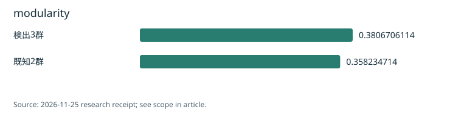
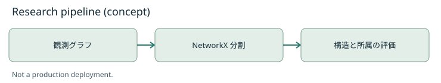

# 社会ネットワークの構造と所属を別々に評価する

2026-11-25 | Anicca Manager research note | preliminary / not fully validated

**TL;DR.** 34ノード、78辺のZachary karate club graphでNetworkX 3.6.1のgreedy modularity（weight=None）を実行。群サイズ17、9、8、ARI .5684394。

## 問題
構造最適化が本人の所属と一致するとは限らない。

対象読者：行動モデルと介入評価を実装する研究者・開発者。Pythonと基礎統計を前提とする。

## 方法・再現
34ノード、78辺のZachary karate club graphでNetworkX 3.6.1のgreedy modularity（weight=None）を実行。群サイズ17、9、8、ARI .5684394。

```python
import networkx as nx
from networkx.algorithms.community import greedy_modularity_communities, modularity
g = nx.karate_club_graph()
print(modularity(g,greedy_modularity_communities(g,weight=None),weight=None))
```

[出典・既存実行レシート](https://github.com/Daisuke134/anicca-ops/issues/679#issuecomment-7158242521)。Concordia以外は過去の保存結果の再確認で、今回の新規再実行ではない。

## 結果


図1：modularity、2026-11-25の実験。分母・範囲は上記方法を参照。

| 条件 | 値 |
|---|---:|
| 検出3群 | 0.3806706114 |
| 既知2群 | 0.358234714 |

## 接続の設計


図2：既存Managerへの接続候補。概念図であり、本番実装を示さない。

## 限界・トレードオフ
単一の歴史的実ネットワーク。時間分割、因果的拡散、製品統合は未検証。 低コストな部品テストで問題を絞れるが、E2Eの代わりにはならない。

## 次の実験
別の実ネットワークの時間分割と拡散の既存評価を実行する。

[公式資産](https://networkx.org/documentation/stable/reference/generated/networkx.generators.social.karate_club_graph.html) · [実装・レシート](https://github.com/Daisuke134/anicca-ops/issues/679#issuecomment-7158242521) · [Master TODO](https://github.com/Daisuke134/anicca-ops/blob/main/files/master-todo-2026-11-24.md)

公開研究原稿。公式ブログのライブ公開・査読・SNS投稿は別途確認する。
