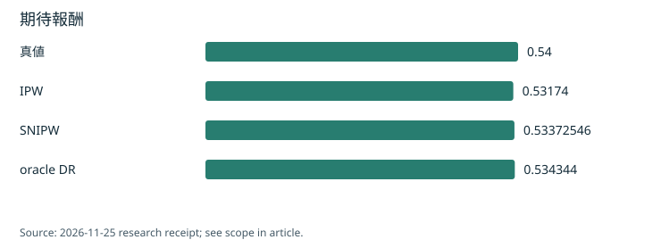
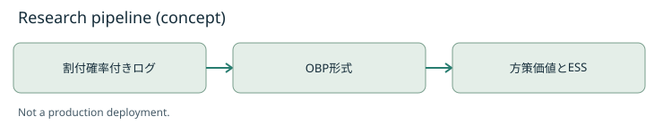

# 新しい介入方策を実際に送る前に評価する

2026-11-25 | Anicca Manager research note | preliminary / not fully validated

**TL;DR.** 合成20,000意思決定、seed42。割付確率.5、評価方策.8、報酬確率.6/.3、真値.54。IPW .53174、SNIPW .53372546、oracle DR .534344。ESS 14676.97。

## 問題
新方策が過去に選ばれなかった行動を選ぶと、評価に十分な支持集合がない。

対象読者：行動モデルと介入評価を実装する研究者・開発者。Pythonと基礎統計を前提とする。

## 方法・再現
合成20,000意思決定、seed42。割付確率.5、評価方策.8、報酬確率.6/.3、真値.54。IPW .53174、SNIPW .53372546、oracle DR .534344。ESS 14676.97。

```bash
python ope_synthetic_smoke.py
python -m unittest -v test_ope_adapter
```

[出典・既存実行レシート](https://github.com/Daisuke134/anicca/pull/9491)。Concordia以外は過去の保存結果の再確認で、今回の新規再実行ではない。

## 結果


図1：期待報酬、2026-11-25の実験。分母・範囲は上記方法を参照。

| 条件 | 値 |
|---|---:|
| 真値 | 0.54 |
| IPW | 0.53174 |
| SNIPW | 0.53372546 |
| oracle DR | 0.534344 |

## 接続の設計


図2：既存Managerへの接続候補。概念図であり、本番実装を示さない。

## 限界・トレードオフ
公式OBPと公式データは未実行。参照数式でありoracle DRのqは真値。人間への効果ではない。 低コストな部品テストで問題を絞れるが、E2Eの代わりにはならない。

## 次の実験
公式Open Bandit Datasetで方策比較を実施し、実人間アウトカムと参加者単位CIを接続する。

[公式資産](https://github.com/st-tech/zr-obp) · [実装・レシート](https://github.com/Daisuke134/anicca/pull/9491) · [Master TODO](https://github.com/Daisuke134/anicca-ops/blob/main/files/master-todo-2026-11-24.md)

公開研究原稿。公式ブログのライブ公開・査読・SNS投稿は別途確認する。
