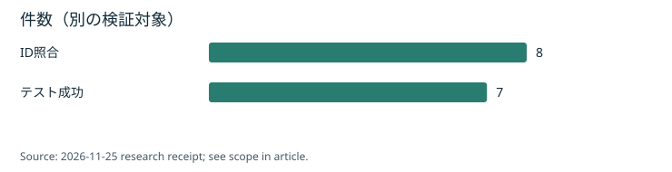
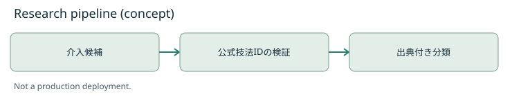

# メッセージ形式と科学的行動変容技法を分離する

2026-11-25 | Anicca Manager research note | preliminary / not fully validated

**TL;DR.** 公式2026-11-10版OWLから8技法の正式ID・ラベル・Publishedを照合。7ローカルテスト成功。

## 問題
質問や内省などの伝達形式から介入技法を一意には判断できない。

対象読者：行動モデルと介入評価を実装する研究者・開発者。Pythonと基礎統計を前提とする。

## 方法・再現
公式2026-11-10版OWLから8技法の正式ID・ラベル・Publishedを照合。7ローカルテスト成功。

```bash
python -m unittest -v test_bcto_annotation
```

[出典・既存実行レシート](https://github.com/Daisuke134/anicca/pull/9492)。Concordia以外は過去の保存結果の再確認で、今回の新規再実行ではない。

## 結果


図1：件数（別の検証対象）、2026-11-25の実験。分母・範囲は上記方法を参照。

| 条件 | 値 |
|---|---:|
| ID照合 | 8 |
| テスト成功 | 7 |

## 接続の設計


図2：既存Managerへの接続候補。概念図であり、本番実装を示さない。

## 限界・トレードオフ
OWL推論、全カタログの自動分類、独立した人間との一致、介入効果は未検証。CC BY 4.0の帰属は元PRに記載。 低コストな部品テストで問題を絞れるが、E2Eの代わりにはならない。

## 次の実験
公式ガイドラインで既存カタログを独立分類し、ManagerBenchタグを接続する。

[公式資産](https://github.com/HumanBehaviourChangeProject/ontologies) · [実装・レシート](https://github.com/Daisuke134/anicca/pull/9492) · [Master TODO](https://github.com/Daisuke134/anicca-ops/blob/main/files/master-todo-2026-11-24.md)

公開研究原稿。公式ブログのライブ公開・査読・SNS投稿は別途確認する。
