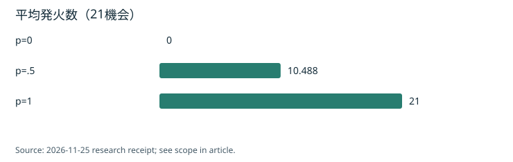
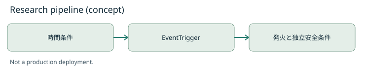

# 介入タイミングの制御と行動効果を区別する

2026-11-25 | Anicca Manager research note | preliminary / not fully validated

**TL;DR.** 公式0.14.1 EventTriggerのクラス本体SHA-256照合。3条件×1000シード×21機会=63,000判定。発火平均0/10.488/21。周期＋期間はOR。

## 問題
タイミング処理の正しさは行動効果の証明ではなく、OR条件は安全上のAND条件の代替ではない。

対象読者：行動モデルと介入評価を実装する研究者・開発者。Pythonと基礎統計を前提とする。

## 方法・再現
公式0.14.1 EventTriggerのクラス本体SHA-256照合。3条件×1000シード×21機会=63,000判定。発火平均0/10.488/21。周期＋期間はOR。

```bash
python econsimulacra_trigger_audit.py --source /path/to/events/base.py
```

[出典・既存実行レシート](https://github.com/Daisuke134/anicca/pull/9493)。Concordia以外は過去の保存結果の再確認で、今回の新規再実行ではない。

## 結果


図1：平均発火数（21機会）、2026-11-25の実験。分母・範囲は上記方法を参照。

| 条件 | 値 |
|---|---:|
| p=0 | 0 |
| p=.5 | 10.488 |
| p=1 | 21 |

## 接続の設計


図2：既存Managerへの接続候補。概念図であり、本番実装を示さない。

## 限界・トレードオフ
全エージェント、経済環境、LLM、公式720ステップは未実行。 低コストな部品テストで問題を絞れるが、E2Eの代わりにはならない。

## 次の実験
公式baselineと6介入条件を対応環境で完走する。

[公式資産](https://github.com/SimulacraBusiness/econsimulacra) · [実装・レシート](https://github.com/Daisuke134/anicca/pull/9493) · [Master TODO](https://github.com/Daisuke134/anicca-ops/blob/main/files/master-todo-2026-11-24.md)

公開研究原稿。公式ブログのライブ公開・査読・SNS投稿は別途確認する。
