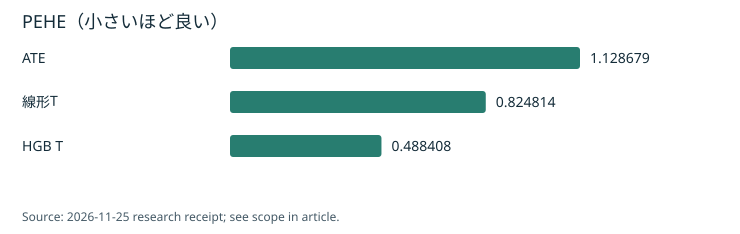
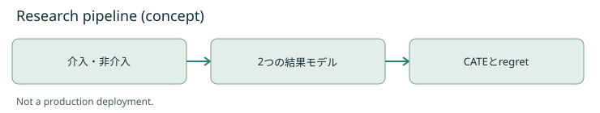

# 成功確率ではなく介入による便益を予測する

2026-11-25 | Anicca Manager research note | preliminary / not fully validated

**TL;DR.** 参照scikit-learn T-learner、5シード×6,000件、独立テスト計10,000件。CATEの真値 .3+.8*x0-.6*x1²。PEHEの平均1.128679/.824814/.488408。

## 問題
介入なしでも成功する人に介入を届けることは、因果効果を最大化するとは限らない。

対象読者：行動モデルと介入評価を実装する研究者・開発者。Pythonと基礎統計を前提とする。

## 方法・再現
参照scikit-learn T-learner、5シード×6,000件、独立テスト計10,000件。CATEの真値 .3+.8*x0-.6*x1²。PEHEの平均1.128679/.824814/.488408。

```bash
python econml_smoke.py --backend reference
# 公式環境で別実行: python econml_smoke.py --backend econml
```

[出典・既存実行レシート](https://github.com/Daisuke134/anicca/pull/9494)。Concordia以外は過去の保存結果の再確認で、今回の新規再実行ではない。

## 結果


図1：PEHE（小さいほど良い）、2026-11-25の実験。分母・範囲は上記方法を参照。

| 条件 | 値 |
|---|---:|
| ATE | 1.128679 |
| 線形T | 0.824814 |
| HGB T | 0.488408 |

## 接続の設計


図2：既存Managerへの接続候補。概念図であり、本番実装を示さない。

## 限界・トレードオフ
公式EconML未実行。人工DGPの真値との比較であり人間の効果ではない。 低コストな部品テストで問題を絞れるが、E2Eの代わりにはならない。

## 次の実験
公式T/S/X/forestを同一Hillstrom凍結分割と既存指標で比較する。

[公式資産](https://github.com/py-why/EconML) · [実装・レシート](https://github.com/Daisuke134/anicca/pull/9494) · [Master TODO](https://github.com/Daisuke134/anicca-ops/blob/main/files/master-todo-2026-11-24.md)

公開研究原稿。公式ブログのライブ公開・査読・SNS投稿は別途確認する。
