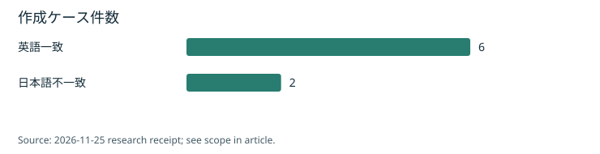
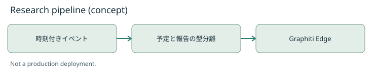

# 予定は実績ではない：時間付き人物モデルの境界

2026-11-25 | Anicca Manager research note | preliminary / not fully validated

**TL;DR.** 公式時間正規化ファイルをimport seam付きで実行。作成した8ケースのうち英語6/6一致、日本語0/2一致。typed projectionの7件成功・公式型1件skip。

## 問題
予定や未来の予測を観測事実として保存すると、時系列漏洩と誤った人物モデルが生じる。

対象読者：行動モデルと介入評価を実装する研究者・開発者。Pythonと基礎統計を前提とする。

## 方法・再現
公式時間正規化ファイルをimport seam付きで実行。作成した8ケースのうち英語6/6一致、日本語0/2一致。typed projectionの7件成功・公式型1件skip。

```bash
python -m unittest -v test_graphiti_projection
```

[出典・既存実行レシート](https://github.com/Daisuke134/anicca/pull/9495)。Concordia以外は過去の保存結果の再確認で、今回の新規再実行ではない。

## 結果


図1：作成ケース件数、2026-11-25の実験。分母・範囲は上記方法を参照。

| 条件 | 値 |
|---|---:|
| 英語一致 | 6 |
| 日本語不一致 | 2 |

## 接続の設計


図2：既存Managerへの接続候補。概念図であり、本番実装を示さない。

## 限界・トレードオフ
全DB・LLM抽出・検索・削除・アクセス制御未検証。2件は一般的な日本語性能を示さない。依存関数の転記を使用。 低コストな部品テストで問題を絞れるが、E2Eの代わりにはならない。

## 次の実験
公式グラフ環境で所有者とシミュレーション分岐、訂正・削除・過去時点検索を検証する。

[公式資産](https://github.com/getzep/graphiti) · [実装・レシート](https://github.com/Daisuke134/anicca/pull/9495) · [Master TODO](https://github.com/Daisuke134/anicca-ops/blob/main/files/master-todo-2026-11-24.md)

公開研究原稿。公式ブログのライブ公開・査読・SNS投稿は別途確認する。
