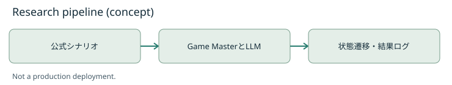

# 社会シミュレーションを完走するだけでは、行動モデルの妥当性は証明できない

2026-11-25 | Anicca Manager research note | preliminary / not fully validated

**TL;DR.** Mac mini、Python 3.12.13、gdm-concordia 2.4.0。公式Networkシナリオの無モデル経路は8人・2サイクルを完走しHTML3件。実LLM SmolLM2-135M F16の上限付き試行は20推論後に選択肢エラーでexit1。JSON Schema制約付き再試行では42件以上の実応答とharvesting段階を確認、終端未確認。

## 問題
エンジンの完走、実LLMの推論、妥当な行動、実人間との一致はそれぞれ別の検証である。

対象読者：行動モデルと介入評価を実装する研究者・開発者。Pythonと基礎統計を前提とする。

## 方法・再現
Mac mini、Python 3.12.13、gdm-concordia 2.4.0。公式Networkシナリオの無モデル経路は8人・2サイクルを完走しHTML3件。実LLM SmolLM2-135M F16の上限付き試行は20推論後に選択肢エラーでexit1。JSON Schema制約付き再試行では42件以上の実応答とharvesting段階を確認、終端未確認。

```bash
python -m examples.resource_dilemma.run --disable_language_model --use_dummy_embedder --scenario=network --num_cycles=2
# sentence-transformers が必要。今回未使用のimport seamを明記。
```

[出典・既存実行レシート](https://github.com/google-deepmind/concordia/tree/d7da4499dd323fc51fce10b38105b3d17fb3651c)。Concordia以外は過去の保存結果の再確認で、今回の新規再実行ではない。

## 結果


図1：確認済み実LLM応答数（別試行）、2026-11-25の実験。分母・範囲は上記方法を参照。

| 条件 | 値 |
|---|---:|
| 上限のみ・失敗 | 20 |
| 制約付き・下限 | 42 |

## 接続の設計


図2：既存Managerへの接続候補。概念図であり、本番実装を示さない。

## 限界・トレードオフ
無モデル経路の埋め込み未使用import seamを使った。空に近い出力は成功行動でない。制約付き試行の終端はこの原稿時点で未確認。実人間との一致も未検証。 低コストな部品テストで問題を絞れるが、E2Eの代わりにはならない。

## 次の実験
制約付き実LLMの終端ログと生の行動妥当率を確認し、他モデル・ルールベース・人間と比較する。

[公式資産](https://github.com/google-deepmind/concordia/tree/main/examples/resource_dilemma) · [実装・レシート](https://github.com/google-deepmind/concordia/tree/d7da4499dd323fc51fce10b38105b3d17fb3651c) · [Master TODO](https://github.com/Daisuke134/anicca-ops/blob/main/files/master-todo-2026-11-24.md)

公開研究原稿。公式ブログのライブ公開・査読・SNS投稿は別途確認する。
