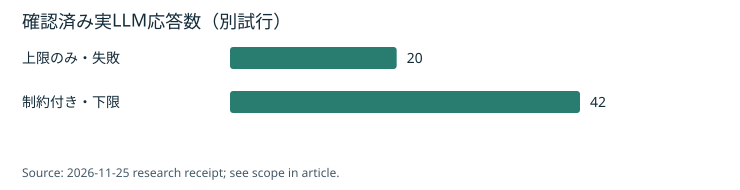

# Concordiaで実LLMを使って社会シミュレーションを完走し、行動品質の失敗を測った

2026-11-25 | Anicca Manager research note | configured scenario E2E, behavior quality FAIL

**TL;DR.** Google DeepMindの公式Concordia 2.4.0をMac miniにインストールし、8エージェントのNetworkシナリオを実LLMで1サイクル完走した。モデル応答79件、終了コード0、HTMLログ3件を確認した。一方、最終行動の指定形式 USE 0–20 の厳密な合格は0/8。エンジンの完走をモデル品質の成功とみなしてはいけない。

## 問題
人間の行動シミュレーションでは、エージェントの自然言語出力を環境が適切な行動に変換しなければならない。ログが生成されること、実LLMを呼ぶこと、行動が有効であること、実人間に一致することは別の検証である。対象読者はPythonを使用する行動AI・マルチエージェント研究者。

## 方法
1. 公式ソース revision d7da4499dd323fc51fce10b38105b3d17fb3651c をsparse cloneし、Python 3.12.13、gdm-concordia 2.4.0、Ollama 0.18.3、ollama Python client 0.6.3を使用。
2. 公式の Network / standard / seed42 の無モデルモード2サイクルを実行。使用しない sentence_transformers の import seam は、コンストラクタが呼ばれたら失敗する形。dummy embedderを使用。8エージェント、終了コード0、HTML3件。
3. SmolLM2-135M F16（Ollama digest 9077fe9d2ae1a4a41a868836b56b8163731a8fe16621397028c2c76f838c6907）を取得。上限なしの最初の試行を長時間応答なしで中止。次の48-token上限試行は20応答後に選択肢エラー、exit1。
4. JSON Schemaのenumで選択肢を制約し64-token上限で再試行。53件の応答ログ（並列採番競合で一意ID46件）を確認、120秒予算で中止。完走とみなさない。
5. 選択肢制約を維持し、24-token上限、2048 context、240秒/180呼出し予算、一意の呼出しIDを導入して公式シナリオ1サイクルを実行。モデルが返す選択肢以外を代入しない。free-text行動はそのまま採点。実行完了を確認。

[再現スクリプト](./concordia_run.py) / [集計レシート](./concordia-receipt.json) / [公式シナリオ](https://github.com/google-deepmind/concordia/tree/d7da4499dd323fc51fce10b38105b3d17fb3651c/examples/resource_dilemma)

```bash
# upstream checkout pinned above, installed gdm-concordia and ollama client
# local Ollama server with smollm2:135m and OLLAMA_HOST configured
python /path/to/concordia_run.py --output-dir /tmp/concordia-result
```

## 結果


図1：2026-11-25の異なる試行における完了した応答ログ行数。64-token試行にはID重複がある。性能比較ではない。

| 条件 | 応答ログ | 終端 | 厳密な行動形式 |
|---|---:|---|---|
| 公式無モデル・2サイクル | 0 LLM | 完走 | 空に近い出力、品質証拠なし |
| 48-token上限 | 20 | 失敗 | 未到達 |
| 64-token＋選択肢制約 | 53（ID46） | 予算超過 | 完成イベントなし |
| 24-token＋選択肢制約 | 79（ID79） | 完走・exit0 | 0/8 |

最終試行は生成1688 token、prompt token計68718（Ollamaの応答メタデータの合計）。3つのHTMLのSHA-256とログのSHA-256はレシートに記録。strict actionは各個人の最終出力が改行後の USE と0〜20の整数で終わることを要求した。例えば数字のみの曖昧な出力や範囲外の値を合格にしていない。モデルは形式不合格であり、社会的協調や資源利用の妥当性を評価できる結果ではない。

## 再利用と設計


図2：公式Game Masterと状態遷移を再利用するManagerの候補設計。まだ本番実装ではない。実モデルを自由文生成器として扱い、最終的な行動を型付きschemaで生成し、範囲・欠測・候補適格性を検証する。シミュレーション内で生成した事実を実世界の人物記憶に書かない。既存Managerの候補ID・BCTOタグ・Graphiti時間情報・OBP方策評価に接続する。

## 限界と次の実験
1サイクル・1シード・1モデル・dummy embedder、選択肢デコードを変更した条件。元の公式LLM設定を完全に再現したわけではない。すべてのシナリオ、標準6サイクル、選挙モード、実人間との比較、Managerの性能改善、本番デプロイは未実施。短い生成は完走に寄与した可能性があるが、条件が複数変わっており因果的に帰属できない。次は最終行動の型付き制約を導入し、より強いモデル・ルールベース・Managerで同一のシナリオを複数シードで比較し、失敗率・資源軌跡・人間との分布一致を測る。行動品質が合格するまで本番に昇格しない。

[Concordia](https://github.com/google-deepmind/concordia) · [Resource dilemma](https://github.com/google-deepmind/concordia/tree/main/examples/resource_dilemma) · [再現実験](./concordia_run.py) · [Manager開発課題](https://github.com/Daisuke134/anicca/issues/9483)
