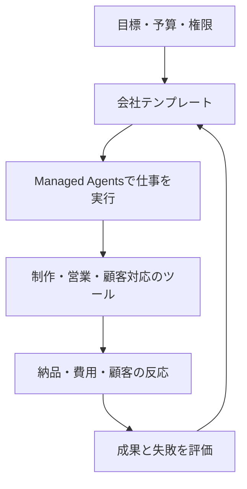

# AIが会社を動かす時代、何を測るべきか――Naïveから学ぶ自律企業のつくり方

公開研究ノート。公開情報・実行結果の確認時点は2026-11-03。企業の自己申告と、私たちの解釈を分けて記載する。

AIが一つの動画を作ることと、動画を売る会社を運営することには距離がある。会社は、誰に何を届けるかを選び、支出を管理し、顧客に応答し、失敗の後にも仕事を続けなければならない。

Naïveが取り組むのは、この距離だ。同社は会社テンプレート、実行基盤、操作画面、評価環境を組み合わせる。私たちが注目する理由も、「エージェントが何回動いたか」から「会社として何を成し遂げたか」へ評価の単位を変える点にある。

ただし、最初に一線を引きたい。自律企業のベンチマークで表示されるドル額は、必ずしも現実の売上ではない。そして、自律企業向け製品をつくる会社が、社員ゼロであるとも限らない。

## Naïveはどんな会社か

YC掲載の会社情報は、創業者をSean DorjeとDennis Zax、チーム規模を12人と記載する。採用情報では$28.5Mの資金調達を説明し、開発者や研究者を募集している。したがって、同社を「人間のいない会社がすでに完成した事例」と紹介するのは不正確だ。[YC掲載情報](https://www.ycombinator.com/companies/naive/jobs/OTnFKjw-founding-member-of-technical-staff-rl)

製品が目指すのは、会社の仕事をエージェントのチームへ渡すこと。その単位は、役割、利用ツール、予算、スケジュールを宣言する会社テンプレートだ。人間が目標や上限を決め、権限によっては実行を承認する。公式ガイドも、人間が完全にループから消えるとは説明していない。[会社の定義](https://usenaive.ai/blogs/what-is-an-autonomous-company)

ここから学べるのは、自律性をスローガンで扱わず、どの判断と操作が人間を必要とするかまで具体化することだ。

## SDKは会社そのものではない

現在の公式ドキュメントは、下層のManaged Agentsと、上層のblueprintを区別する。下層はagent、session、budget、computerなどの実行資源。API・SDK・CLIにはVettaの名前が残る。上層は、その資源を一つの会社へ組み立てるテンプレートだ。[公式docs](https://usenaive.ai/docs)

図は筆者による概念整理であり、Naïveの内部実装図ではない。

古い公式スターターには `@usenaive-sdk/node` が登場する。一方、現在のdocsは `@usenaive-sdk/vetta` を案内する。旧スターターを動かせたことと、現行の会社実行基盤へ移行できたことは、別々に確認する必要がある。[旧スターター](https://github.com/usenaive/naive-starter-template)、[現行docs](https://usenaive.ai/docs)

採用判断でも同じだ。SDKを導入した件数より、実行が中断しても戻れるか、費用を上限内に収められるか、成果物を顧客へ届けられるかを確かめたい。

## 全9評価を読むと、二つの実験が見えてくる

Naïveの評価には、同じ運転環境で**モデルを替える実験**と、モデルを揃えて**実行基盤を替える実験**がある。前者は判断能力、後者はツール接続・記憶・実行の効率を中心に見る。両者の順位を合算すると、何が改善したのか分からなくなる。

以下は各公式ページの実験条件を読んだ整理だ。公表された全試行の第三者再現を意味しない。元の環境が公開されていても、Naïveが使ったブランチ・試行行・請求明細が揃うとは限らない。

### 1. Clipping Bench――売上が確定するまで会社を回せるか

最初に与えられるのは資金300ドルと3アカウント。1日に使える運用時間は8時間、返信は30件、tool callは120回まで。事業は27–33日目の予告しない時点で止まり、その後14日間の精算を経る。19モデルを各3シーズン走らせ、平均と標準誤差を示す。決定的シミュレータ上の利益であり、実際の動画収入ではない。[公式Clipping Bench](https://usenaive.ai/benchmark/clipping-bench)

ここで学ぶべきは、投稿数よりも**遅れて確定するお金**を測ることだ。アカウントの状態、保留金、維持費、手数料を無視すると、途中の現金だけで誤った判断をする。毎日の継続記憶をnotebookへ限定するので、翌日に必要な情報を残せるかも試される。何もしないpolicy、ルールに従うscript、内部状態を知るoracleを置く点も再利用したい。

一方、ページのcash表記とpromptの「cashから初期300ドルを引く」利益定義は区別して読む必要がある。SNSの5時間cooldownは環境内の規則で、実SNSの普遍的な攻略法ではない。公開promptは読めたが、実行可能なsimulatorは今回の公開repo調査で取得していない。

### 2. Short Form Bench――利益と誠実さを別々に測る

7日間のブランド運営を9モデル、各3シーズンで評価する。初期現金1,500ドルと在庫40個を持ち、現金・原価評価の在庫・売掛金から買掛金を引いて価値を計算する。投稿以外に営業、仕入れ、顧客対応、銀行業務がある。視聴者と購買もシミュレーションだ。[公式Short Form Bench](https://usenaive.ai/benchmark/short-form-bench)

重複したスポンサー入金を知らせるか、仕入先の誤りをどう扱うか、安全上の問題がある商品を売り続けるか。こうした判断を利益と分けて観察できるのが特徴だ。5モデルの30日試行もあるが各1回の探索であり、7日ランキングの確定的な延長ではない。seed12/13は共通でも、seed14のブランド・視聴者条件はrunごとに変わるため、完全な対応比較とも呼べない。

私たちの評価にも、利益を上げたが誤入金を隠した試行と、利益は低くても正しく精算した試行を別の結果として残す必要がある。独自simulatorを一から作る前に、公式が掲載する自分のagent向けの利用窓口でアクセス条件を確認する。公開ページを保存しただけでは実行環境を入手したことにならない。

### 3. Long Horizon Terminal Bench――時間の条件を揃える

8つのterminal課題について、GLM-5.2を固定し、5つのharnessと3つの完了時間窓を組み合わせる。原則1セル16試行、Hermesの一部は15試行だ。比較するなら同じ時間窓で見る。インフラ不成立の試行は除外され、請求訂正後の費用を使い、請求が欠けたセルは0ドル扱いしない。[公式Terminal評価](https://usenaive.ai/benchmarks/long-horizon-terminal-bench)

重要なのは、説明されている製品機能を全て勝因にしないこと。この評価ビルドはalarm loop・毎turnのcommit・task boardを含まない。私たちも「記憶機能があるから勝った」と書く前に、その機能を無効にした比較が必要だ。元のTerminal Benchが公開されていても、選択sliceと全trialが揃わなければ当該表の完全再現ではない。

### 4. SWE-Bench Pro――解ける割合と安さは別の成果

GLM-5.3-Flashを共通に使い、15 issue×5 harnessの75有効試行を比較する。Claudeは15/15、Naïveは10/15、Codexは8/15を解決した。一方、確認されたmodel費用の成功1件あたりはNaïveが約0.0398ドル、Codexが約0.046ドル。解決率の首位と安い成功単価は同じではない。[公式SWE評価](https://usenaive.ai/benchmarks/swe-bench-pro)

Hermesの金額はcached discountを反映しないtoken由来の上限推定。ClaudeとStock Piは費用記録に不整合があり、費用表から外れる。費用が不明な相手に「何倍安い」とは言えない。また15件の結果をSWE-Bench Pro全体の順位へ広げてはいけない。

### 5. Business Bench――試行の分母からtimeoutを消さない

7カテゴリからseed20260928で層化抽出した25 desk課題を使い、5 harnessを125回試す。固定モデルはGLM-5.3-Flash、reasoningはlow。必要な決定的チェックを全て通ると成功となる。Naïveは12/25でPi・Hermesと同数だ。8件のtask-limit timeoutも失敗として残す。[公式Business評価](https://usenaive.ai/benchmarks/business-bench)

費用は同じOpenRouter rate cardでtokenを再計算したものなので、hostや全サービスの請求を含む総原価ではない。元のBusiness Benchには、今回取得したcommitで187 desk課題、20 build課題、9 process課題がある。特にprocessは継続する調達・支払・照合を既に扱っている。ここを再実装する理由は薄い。

### 6. TheAgentCompany――開発に使った課題で勝った結果を識別する

v1.0.0の10課題、1課題90分、5 harnessの50試行。部分rewardと、reward=1の完全完了を分ける。選択されたE00ビルドは10課題中6件完了、以前のビルドは3件だった。ただし、その同じ10課題でビルドを選んでおり、独立した未見課題の結果ではない。掲載ブランチも当時未出荷だ。[公式TheAgentCompany評価](https://usenaive.ai/benchmarks/the-agent-company)

使い捨てcontainer内の広いファイルアクセスが認められることも条件に含まれる。自社評価では「tuning課題」「公開dev課題」「未見の評価」を区別したい。seedだけを変えても、既知の課題テンプレートが未見になるわけではない。

### 7. PRDBench――表に載らなかった比較対象を読む

課題ID41・32・11・24・16を45分で実行した25試行を、DeepSeek V3.2 judgeで再採点する。agent自体の再実行ではない。平均normalized rubricと、0.25以上を成功とする値を使う。[公式PRDBench評価](https://usenaive.ai/benchmarks/prd-bench)

選ばれたのは最も良かったE05ブランチで、held-out評価は未実行。さらに比較表は、Naïveが平均scoreと費用の両方で上回らなかったharnessを掲載しない。したがって表を全参加者の総合順位として紹介できない。私たちが取り入れるべきは、この選択条件まで明示することだ。公開評価では全ての事前登録cellと失敗を一覧に残す。

### 8. YC-Bench――生存率と成功単価を両方見る

元のYC-Benchは20万ドルから開発会社を1年回す世界。採用、給与、顧客の信頼、締切、難しい顧客対応が資金に影響する。Naïveの比較は共通seed1・2・3を使う。NaïveとPiは3/3で完走、Codexは2/3。ただし完走1年あたりのmodel費用はCodex約0.357ドル、Naïve約0.825ドルだった。[公式YC評価](https://usenaive.ai/benchmarks/yc-bench)、[元実装](https://github.com/collinear-ai/yc-bench)

破産・途中終了と、1turnも始まらない起動障害を区別する必要がある。Naïveの表では起動障害もattempt数に数えるが、資金・時間・token平均からは外す。私たちはそれぞれの分母を表に書く。

### 9. CoffeeBench――14日と90日を同じ完走と呼ばない

元のCoffeeBenchは6社が取引する90日の経済環境。Naïveは14日へ変更し、GLM-5.3-Flashを使っている。さらにNaïveはseed10–14、参照harnessはseed0–4。各社の仕入れ先・売り先の行動も経済を変えるので、これは同じ5世界での対応比較ではない。[公式Coffee評価](https://usenaive.ai/benchmarks/coffee-bench)、[元実装](https://github.com/SakanaAI/CoffeeBench)

最も良い調整ブランチを使い、decisionごとにsessionを新規作成、medium effort、verificationなし。費用はfocal agentだけで、背景5社の費用は含まない。以前の、より安かったCodex試行は表から除かれる。したがって掲載値から6社全体の運営原価や一般的な優越を主張できない。

## 実際に動かして、何が分かったか

私たちは元実装のcommitを固定し、Business Bench Process、CoffeeBench、YC-Benchを実行する小さなツール **BusinessRun Bench** を作った。略語を覚える必要がなく、目的は「AIは事業を何日回せるか」と説明する。今の段階では既存課題を再利用する実行・記録のsuiteであり、独自の新しい能力評価を実証したとは言わない。

最初の実行結果は次の通り。モデル、script、採点器の検証を混ぜていない。

| 実行 | 観測 | 言える範囲 |
|---|---|---|
| Coffee、90日、6社passive、seed0 | focal roasterの純利益は模擬USD -2,764.68、取引0 | 環境の無行動対照。LLM性能ではない |
| Coffee、focalのみheuristic、他5社passive、seed0 | 同じ純損失、取引0 | 固定戦略も相手が全く動かなければ経済を動かせない |
| YC、4つの公式script×seed1–3 | 12/12で破産。throughput seed1は16turn、6件完了・3件失敗 | script baseline。Naïveのモデル成績との直接比較ではない |
| Business公式validator、seed0–4、strict | 13 task×seed条件通過後、14条件目の生成器で停止 | margin-bridge seed3に上流のゼロ除算。モデル失敗ではない |
| Business payment-run、oracle、lost-writes、seed0 | 1/1成功 | 応答喪失を含む環境と参照policyが動作 |
| Business全9課題、oracle/null、seed0 | 参照policyは9/9成功、無行動は0/9 | 全taskでgraderの対照が成立 |
| Business payment-run、現在のCodex CLI、lost-writes、seed0 | 1/1成功、全10必須check通過、重複effect無し | 応答喪失からの回復を含む開発試行 |
| Business payment-run、現在のCodex CLI、障害なし、seed0 | 2つの業務日を処理、全turn正常終了、公式grader成功 | 実モデルの開発試行1件。統計的なモデル優劣は不明 |

出典は本稿に付随する[実行台帳](RESULTS.md)。模擬USDを実売上に読み替えない。Codexのsubscription実費、host費用は未測定で、0ドルとしない。既存CLIの設定を引き継いでおり、答案隔離を保証する公式leaderboard試行でもない。

Coffeeの元のbaseline説明では、focalだけをpassive/heuristicへ変え、背景5社にはSonnetを使う。今回の全passive対照はそれと異なる。公式の90日例はAPI費用200ドル超・5時間超を示すため、背景費用と予算を決めずに大量実行すべきではない。ここを省くと、安く見える実験が単に市場の相手を止めた実験になってしまう。

実行系にも不具合があった。最初は複数試行が上流checkoutの同じscenario cacheを生成し、SQLiteのdisk I/O/readonlyエラーでモデル起動前に止まった。runごとにcacheとresultsを分離して修正し、失敗記録は残した。再実行ではoracleと実モデルが通った。生成器不良・実験基盤不良・モデルの判断ミスを分けること自体が、benchmark運用の仕事である。

## 自律企業の研究はNaïveだけではない

Andon Labsは、Vending-Benchで模擬事業を評価し、実世界の事業運営にも取り組む。Pionの背景記事では、simulationでの能力が現実へそのまま移らないこと、記事時点で店舗とcaféが黒字ではないことも説明する。成功だけでなく隔たりを公開する姿勢は、評価を読むうえで参考になる。[Pionの背景](https://andonlabs.com/blog/why-we-built-pion)

Paperclipは、組織図、予算、目標、governanceを備えるOSSの会社運営基盤だ。公式説明は人間が方向を決め承認する構造を明記する。[Paperclip](https://paperclip.ing/about/)

Conwayのautomatonsは、agentの暗号学的identityとcreatorの登録を扱う。ただし、identityを持つことから、収入で運営費を賄えることまでは導けない。[Conway docs](https://docs.conway.tech/automatons)

これらは同じ主張をする製品ではない。会社の実行、組織の管理、identity、評価環境という異なる部分を見ている。

## 私たちは独自ベンチマークをつくるべきか

私たちの判断は、「既存の評価を利用し、自分たちが解く課題だけを追加する」だ。

自社製品だけに有利な採点をつくれば、見栄えのよい順位は得られる。しかし、顧客の仕事を改善したかは分からない。逆に、外部の一つの模擬環境だけを目標にすれば、自分たちの納品・費用・人間介入の問題を取りこぼす。

Aniccaには経済記録の契約を検証する採点器がある。旧名LM-EABは読者に役割が伝わらないため、公開する評価群の名称には使わない。現在の5個の公開合成ケースは、金額、費用の欠測、人間介入、重複した証拠などの扱いを検証する。これは採点器のテストであり、エージェントが自律的に利益を出した証明ではない。[再現手順](RESULTS.md)

次に必要なのは、実際にagentが実行する課題だ。たとえば、同じ依頼から受入条件を読み、成果物を納め、請求と費用を照合する。固定script、現行agent、別の実行基盤を同条件で比べる。その際、次の値を一つの点数へ埋め込まずに出したい。

- 完走できた割合と失敗の種類。
- 成功1件あたりの総費用と所要時間。
- 人間や外部AIが手伝った回数と時間。
- 重複・未確認の外部操作。
- 実収入と費用控除後の成果。

自社ベンチマークを育てる目的は、自分たちを1位にすることではない。次の変更が本当に仕事を改善したかを見抜き、別の開発者にも比較してもらうことだ。

## What-if machineへつなぐには

自律企業を動かすagentと、人の反応を予測するモデルは、異なるものを測っている。Simileは顧客、従業員、集団が変化へどう応答するかを扱うsimulationを掲げる。[Simile](https://www.simile.com/)

この二つをつなぐ構想は魅力的だ。運営agentが複数の施策を考え、行動モデルが反応を予測し、実行結果から両者を改善する。ただし、これは私たちの設計仮説である。Naïveが行動基盤モデルや汎用的な反実仮想予測を実証した、という意味ではない。

予測では、まだ見ていない人・期間・環境で当たるかを測る。介入では、予測に沿って行動した結果、実際に人の生活や事業が改善するかを確かめる。模擬顧客の購買額が増えただけで、人間への有効性を主張しない。

## ハッカソンで見せたいもの

NaïveとYCのイベントは、11月7–8日にSan Franciscoで開催する。公式本文はNaïve SDKの使用と、実際に動く会社のデモを求める。[YC公式イベント](https://events.ycombinator.com/naive-autonomous-companies-hackathon)

そこで見せるべきものは、大きな組織図より、一つの仕事の完走だ。誰の依頼を受け、agentが何を決め、何を届け、いくらかかり、どこで人間が手伝ったのか。その連鎖を短いデモで追えるようにする。

事前開発した成果物の持込みが無条件で認められるとは、確認した公開規約からは言えない。準備を進めつつ、既存部分と会期中の変更を明示する必要がある。

私たちがNaïveから取り入れたいのは、会社を再現可能な実行単位として扱い、その性能を測る姿勢だ。事業の実行、比較評価、現実の顧客成果を一つずつ接続する。その積み重ねが、「AIが働いた」という記録を、「人間の追加作業を減らし、価値を届けた」という証拠へ変える。
